# Demo Screenshot Gallery

Every tracked skill is shown as a real browser rendering of its local `demo/index.html`.

- Captured demos: 142
- Browser viewport: 1280 x 720 (a few source pages export a slightly scaled JPEG)
- Format: JPEG
- Reveal hover effect: includes both default and interaction states

Open the [visual browser gallery](SCREENSHOTS.html), or see [DEMOS.md](DEMOS.md) for the complete demo, prompt, and source index.

## 3d (9)

### 3d-falling-leaves

Build recognizable falling leaves in world space using instanced geometry, independent tumble, coupled sideways drift, shared wind, scene occlusion, and camera-aware recycling. Use for 3D autumn leaves or drifting foliage in Three.js and similar scenes; use falling-leaves for a 2D canvas overlay.

[Open demo](agent-skills/3d/3d-falling-leaves/demo/index.html) · [Skill](agent-skills/3d/3d-falling-leaves/SKILL.md) · [Prompt](agent-skills/3d/3d-falling-leaves/demo/PROMPT.md) · Local demo

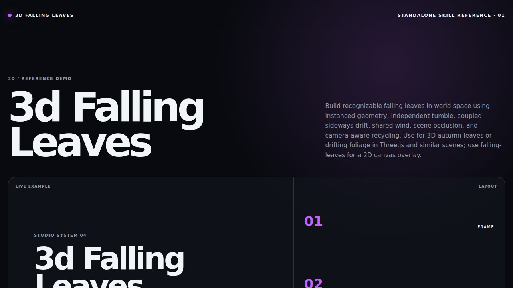

### 3d-four-seasons

Add coordinated spring, summer, fall, and winter states to a 3D scene, blending foliage, sunlight, sky, ground materials, snow, and particles without rebuilding the world. Use for seasonal controls, architectural walkthroughs, and outdoor scenes with four-season transitions.

[Open demo](agent-skills/3d/3d-four-seasons/demo/index.html) · [Skill](agent-skills/3d/3d-four-seasons/SKILL.md) · [Prompt](agent-skills/3d/3d-four-seasons/demo/PROMPT.md) · Local demo

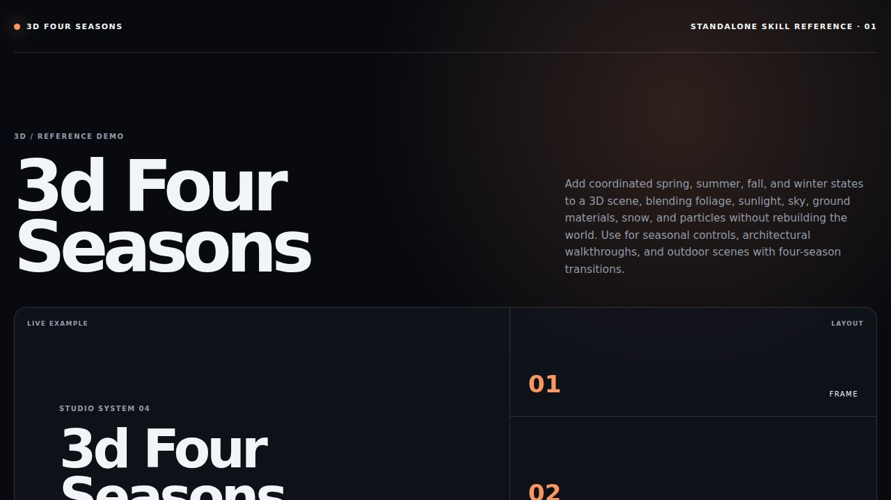

### 3d-high-poly-models

Create or integrate highly detailed 3D models with smooth silhouettes, shaped surfaces, believable bevels, and close-up geometry, then prepare suitable runtime LODs and loading. Use when a user requests high polygon counts, ultra-realistic models, detailed architectural assets, or removal of visibly faceted geometry.

[Open demo](agent-skills/3d/3d-high-poly-models/demo/index.html) · [Skill](agent-skills/3d/3d-high-poly-models/SKILL.md) · [Prompt](agent-skills/3d/3d-high-poly-models/demo/PROMPT.md) · Local demo

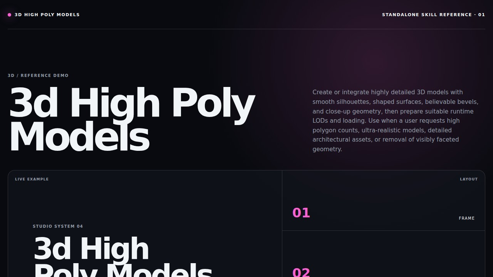

### 3d-high-resolution-textures

Build sharp, physically coherent high-resolution materials for 3D rendering with appropriate PBR maps, texel density, UV direction, mipmaps, anisotropic filtering, and progressive asset delivery. Use for detailed wood, stone, fabric, foliage, and architectural close-ups without excessive download or GPU memory costs.

[Open demo](agent-skills/3d/3d-high-resolution-textures/demo/index.html) · [Skill](agent-skills/3d/3d-high-resolution-textures/SKILL.md) · [Prompt](agent-skills/3d/3d-high-resolution-textures/demo/PROMPT.md) · Local demo

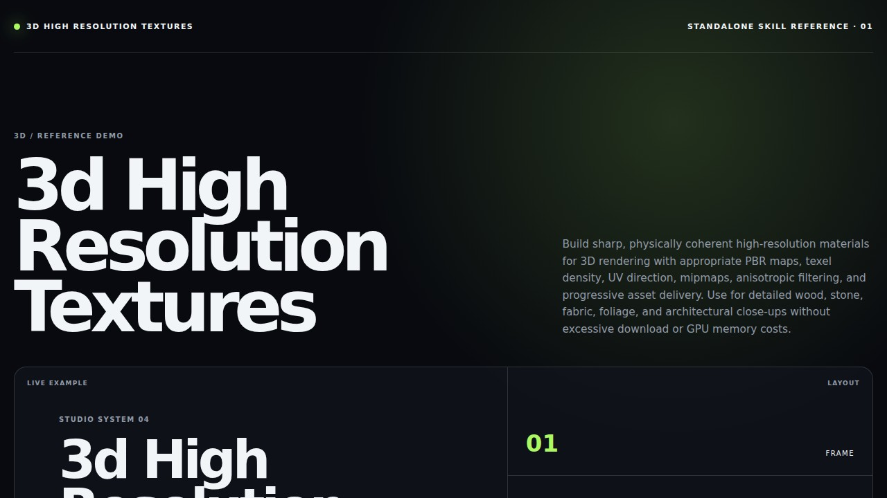

### 3d-retina-resolution

Render a 3D canvas sharply on Retina and HiDPI displays, including explicit 200 percent resolution, synchronized renderer and post-processing sizes, correct pointer coordinates, and measured quality fallbacks. Use for blurry WebGL output, 2x rendering, high-resolution previews, and display-density changes.

[Open demo](agent-skills/3d/3d-retina-resolution/demo/index.html) · [Skill](agent-skills/3d/3d-retina-resolution/SKILL.md) · [Prompt](agent-skills/3d/3d-retina-resolution/demo/PROMPT.md) · Local demo

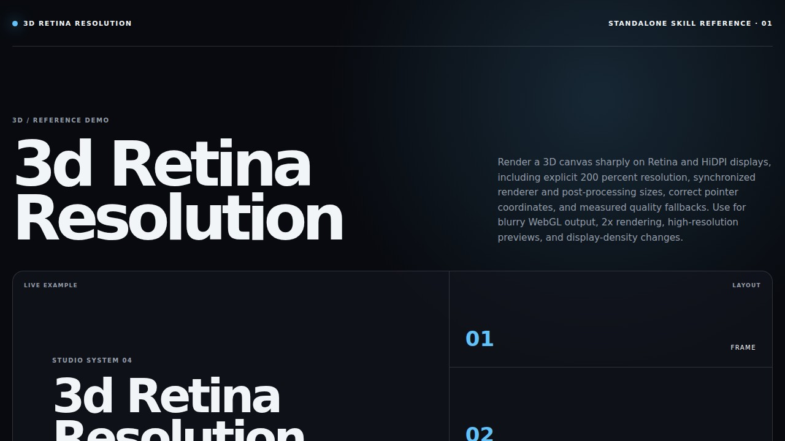

### 3d-sky-background

Create a camera-correct sky background for a 3D scene with a procedural atmosphere or panorama, horizon haze, aligned sunlight, and coherent environment lighting. Use for architectural skies, outdoor 3D backgrounds, golden hour, and day-to-night sky transitions.

[Open demo](agent-skills/3d/3d-sky-background/demo/index.html) · [Skill](agent-skills/3d/3d-sky-background/SKILL.md) · [Prompt](agent-skills/3d/3d-sky-background/demo/PROMPT.md) · Local demo

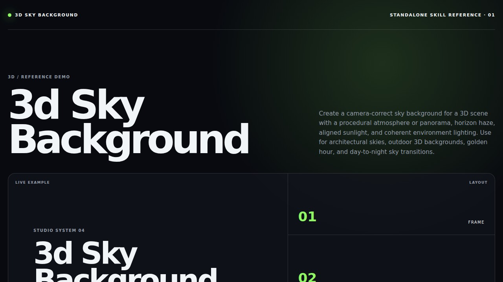

### 3d-sky-rays

Add sun shafts and crepuscular rays to a Three.js or equivalent 3D scene, using scene occlusion, a projected sun position, controlled foreground spill, and scalable post-processing. Use for rays of light from the sky, sunlight through trees or roofs, and golden-hour architectural scenes.

[Open demo](agent-skills/3d/3d-sky-rays/demo/index.html) · [Skill](agent-skills/3d/3d-sky-rays/SKILL.md) · [Prompt](agent-skills/3d/3d-sky-rays/demo/PROMPT.md) · Local demo

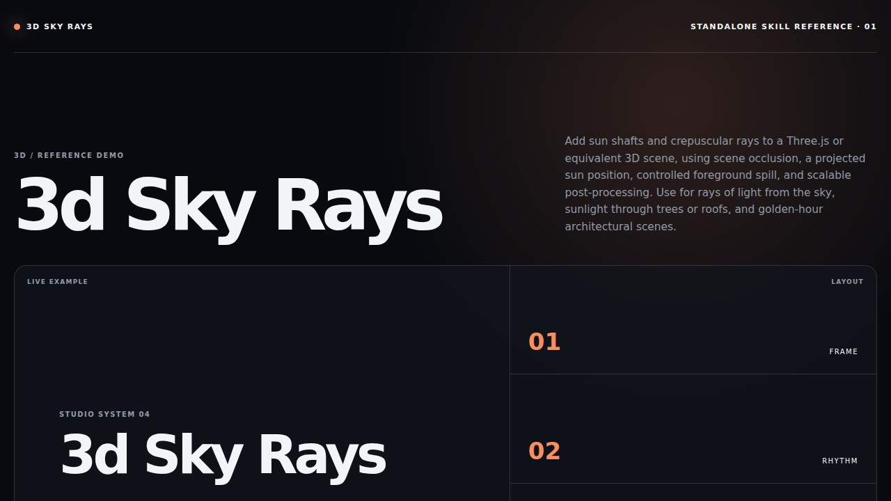

### 3d-ultra-realistic-water

Build an ultra-realistic open ocean in Three.js with a deep-water Gerstner spectrum shaded per pixel from analytic derivatives, each wave faded at its own pixel footprint, plus Fresnel sky-cube and planar reflections, subsurface light through the crests, HDR sun glitter, Jacobian lace foam, a Kelvin wake, hull foam, buoyancy queries and aerial perspective into the sky's horizon haze. Use for seas, oceans, sunset or daylight water, sun glitter paths, ship or boat scenes, wakes, coastal flyovers and any 3D scene with a moving camera and a water horizon. Includes the approved water from Pirate Ship Sunset as a reusable module and demo.

[Open demo](agent-skills/3d/3d-ultra-realistic-water/demo/index.html) · [Skill](agent-skills/3d/3d-ultra-realistic-water/SKILL.md) · [Prompt](agent-skills/3d/3d-ultra-realistic-water/demo/PROMPT.md) · Local demo

### 3d-virtual-tour

Build guided and interactive virtual tours through a 3D environment with authored camera paths, room and floor-plan navigation, orbit inspection, smooth mode handoffs, and progressive loading. Use for architectural walkthroughs, real-estate tours, museums, showrooms, and explorable spaces built with Three.js or a similar renderer.

[Open demo](agent-skills/3d/3d-virtual-tour/demo/index.html) · [Skill](agent-skills/3d/3d-virtual-tour/SKILL.md) · [Prompt](agent-skills/3d/3d-virtual-tour/demo/PROMPT.md) · Local demo

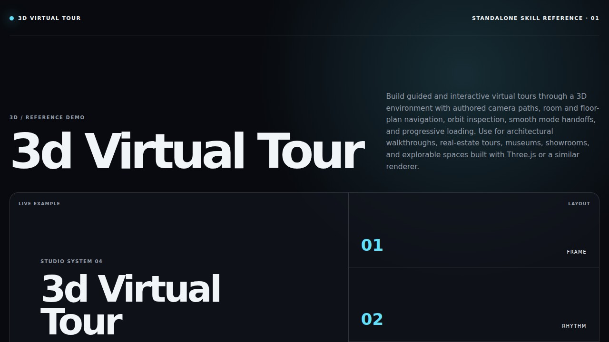

## codex (20)

### article-prompts-to-skills

Convert an article, tutorial, or prompt pack into focused reusable AgentSkills, one independent capability per skill, with portable instructions, example prompts, working demos, preview screenshots, validation, gallery updates, and a narrow commit. Use when the user asks to turn an article's prompts, tutorial sections, design patterns, interactions, or workflow ideas into complete skills rather than leaving them as prose.

[Open demo](agent-skills/codex/article-prompts-to-skills/demo/index.html) · [Skill](agent-skills/codex/article-prompts-to-skills/SKILL.md) · [Prompt](agent-skills/codex/article-prompts-to-skills/demo/PROMPT.md) · Local demo

### audit-reference-originality

Audit a website or digital experience against its supplied source references for originality and plagiarism risk. Use when Codex must compare current or historical site output with reference pages, capture packs, screenshots, copy, brands, numbers, images, assets, videos, layouts, motion, or code; raise evidence-backed red flags; distinguish common visual grammar from distinctive copying; and propose concrete fixes without making unsupported legal claims.

[Open demo](agent-skills/codex/audit-reference-originality/demo/index.html) · [Skill](agent-skills/codex/audit-reference-originality/SKILL.md) · [Prompt](agent-skills/codex/audit-reference-originality/demo/PROMPT.md) · Local demo

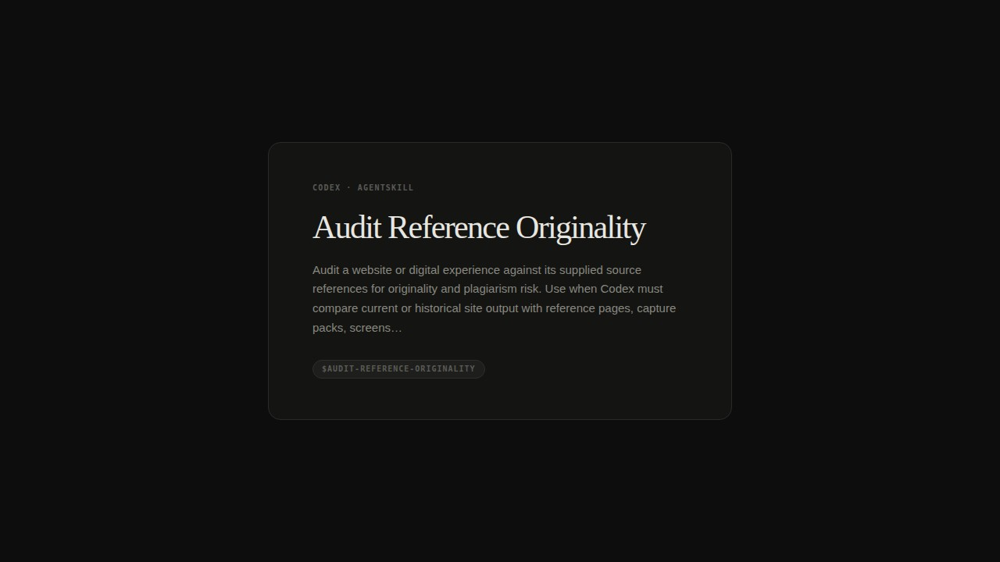

### audit-verify-explain-grade-5

Audit work, verify claims with concrete evidence, and explain the result in simple grade-5 language. Use when the user asks to review, audit, check, verify, explain a change, explain a fix, summarize test results, validate whether something works, or translate technical findings into plain language for non-technical readers.

[Open demo](agent-skills/codex/audit-verify-explain-grade-5/demo/index.html) · [Skill](agent-skills/codex/audit-verify-explain-grade-5/SKILL.md) · [Prompt](agent-skills/codex/audit-verify-explain-grade-5/demo/PROMPT.md) · Local demo

### browser-video-recording

Create polished 60 fps 4:3 4K browser screen-recording style videos from Codex in-app browser captures, with browser-only crop, natural macOS cursor styling, deliberate click choreography, zoom-follow framing, ffprobe/thumbnail verification, and optional native recording compatibility checks. Use when the user asks to record or re-record browser actions, show cursor clicks and zooms, make Dribbble/UI inspiration or product demo recordings, or asks whether Codex, Playwright, or an MCP can produce a natural browser demo video.

[Open demo](agent-skills/codex/browser-video-recording/demo/index.html) · [Skill](agent-skills/codex/browser-video-recording/SKILL.md) · [Prompt](agent-skills/codex/browser-video-recording/demo/PROMPT.md) · Local demo

### build-daily-inspiration-sites

Turn a completed daily UI inspiration capture into exactly five original landing-page builds, one per separate Codex task, using Sites. Use when the user asks to turn the daily inspiration references, a five-item UI prompt pack, or a dated `*-ui-inspiration-capture` article into distinct HTML landing pages while changing the source brands, names, copy, people, numbers, pricing, claims, and imagery.

[Open demo](agent-skills/codex/build-daily-inspiration-sites/demo/index.html) · [Skill](agent-skills/codex/build-daily-inspiration-sites/SKILL.md) · [Prompt](agent-skills/codex/build-daily-inspiration-sites/demo/PROMPT.md) · Local demo

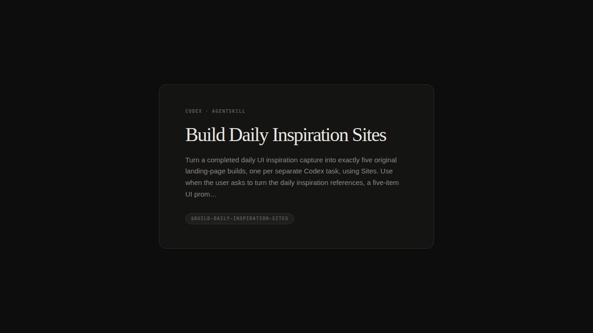

### codex-gpt-image-2-5-flare

Generate or edit artwork with built-in Codex image gen, especially transparent PNG ornaments, game sprites, emblems, and UI graphics. Use when the user requests GPT 2.5 Flare, /codex-gpt-image-2-5-flare, or this built-in transparent-asset workflow. Includes alpha verification, prompt preservation, and optional project integration.

[Open demo](agent-skills/codex/codex-gpt-image-2-5-flare/demo/index.html) · [Skill](agent-skills/codex/codex-gpt-image-2-5-flare/SKILL.md) · [Prompt](agent-skills/codex/codex-gpt-image-2-5-flare/demo/PROMPT.md) · Local demo

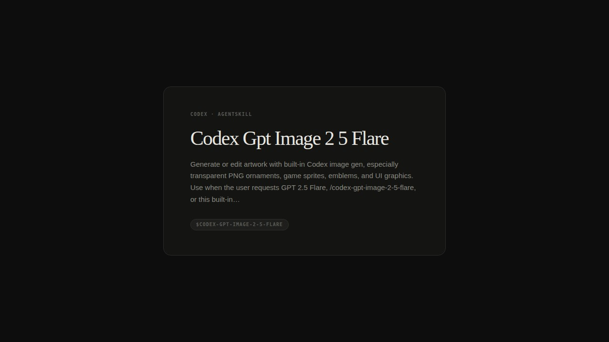

### daily-ui-inspiration-capture

Create a recurring daily UI inspiration capture. Use when the user asks to run, refresh, package, or validate dated UI inspiration bundles, especially for `articles/YYYY-MM-DD-ui-inspiration-capture/` outputs, Framer/Dribbble landing-page inspiration, motion-study screenshots/videos, AI-builder prompts, duplicate checking, or converting a project runbook into repeatable workflow.

[Open demo](agent-skills/codex/daily-ui-inspiration-capture/demo/index.html) · [Skill](agent-skills/codex/daily-ui-inspiration-capture/SKILL.md) · [Prompt](agent-skills/codex/daily-ui-inspiration-capture/demo/PROMPT.md) · Local demo

### elevenlabs-tts

Generate ElevenLabs text-to-speech audio from scripts or inline text using local voice profiles. Use when the user asks for ElevenLabs, text-to-speech, TTS, narration, voiceover, speech audio, or voice generation; load voice names, voice ids, emails, owners, and account-specific defaults only from local config outside the skill.

[Open demo](agent-skills/codex/elevenlabs-tts/demo/index.html) · [Skill](agent-skills/codex/elevenlabs-tts/SKILL.md) · [Prompt](agent-skills/codex/elevenlabs-tts/demo/PROMPT.md) · Local demo

### generate-reference-inspired-brand-worlds

Generate multiple original brand campaign worlds from a supplied visual reference while controlling how close the new work feels without copying protected signature elements. Use when a user provides a brand identity image, poster, editorial campaign, moodboard, or generated concept and asks for inspired alternatives, several distinct brands in one visual family, a closer-to-reference V2, exact wordmarks inside images, or originality-safe image-generation prompts and outputs.

[Open demo](agent-skills/codex/generate-reference-inspired-brand-worlds/demo/index.html) · [Skill](agent-skills/codex/generate-reference-inspired-brand-worlds/SKILL.md) · [Prompt](agent-skills/codex/generate-reference-inspired-brand-worlds/demo/PROMPT.md) · Local demo

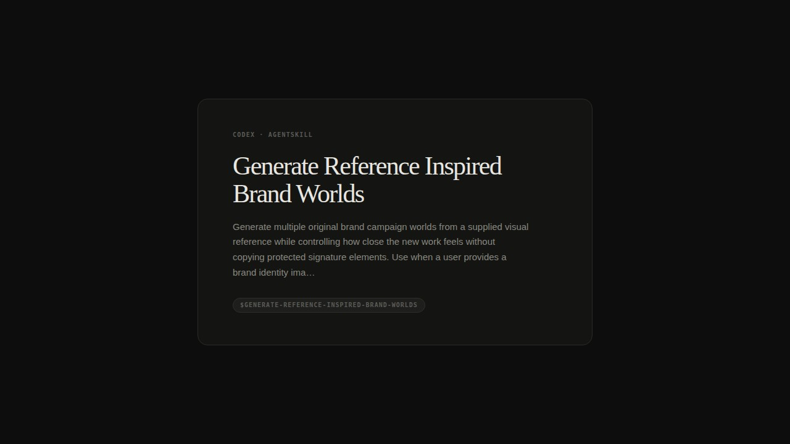

### html-to-interaction-prompts

Convert a supplied HTML page or generated HTML reference into a screenshot-backed article containing multiple reusable interaction prompts. Use when the user provides an HTML file, exported page, generated-page.html, or local/live reference and asks to extract animation/interactions, create prompts, capture screenshots for each prompt, add them to an article, or commit the resulting article/assets.

[Open demo](agent-skills/codex/html-to-interaction-prompts/demo/index.html) · [Skill](agent-skills/codex/html-to-interaction-prompts/SKILL.md) · [Prompt](agent-skills/codex/html-to-interaction-prompts/demo/PROMPT.md) · Local demo

### implement-fog-of-war

Implement, tune, debug, or validate soft wall-aware fog of war and gameplay perception in Three.js action games. Use for orthographic or isometric visibility masks, obstacle-aware line of sight, player and enemy vision ranges, hidden-enemy targeting rules, fog shader artifacts such as spokes or seams, mobile ray budgets, lifecycle and menu-state integration, and deterministic fog-of-war tests.

[Open demo](agent-skills/codex/implement-fog-of-war/demo/index.html) · [Skill](agent-skills/codex/implement-fog-of-war/SKILL.md) · [Prompt](agent-skills/codex/implement-fog-of-war/demo/PROMPT.md) · Local demo

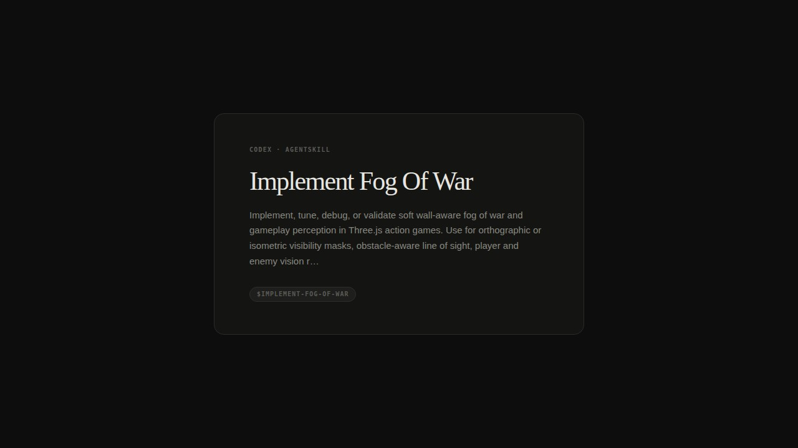

### iterate-until-verified

Apply a prompt-agnostic execution and verification loop to any substantial task while preserving the original request. Use when the user asks to fan out work, use subagents or independent reviewers, loop until done, benchmark against references, apply a harsh critic, compare candidates blind, improve an existing prompt with verification, or continue until explicit quality gates pass.

[Open demo](agent-skills/codex/iterate-until-verified/demo/index.html) · [Skill](agent-skills/codex/iterate-until-verified/SKILL.md) · [Prompt](agent-skills/codex/iterate-until-verified/demo/PROMPT.md) · Local demo

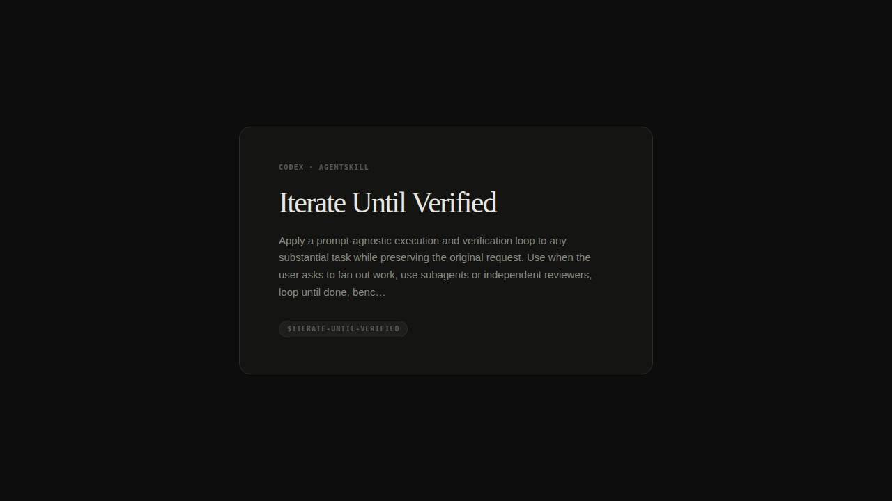

### optimize-web-animations

Profile, audit, and optimize frontend page performance with emphasis on animation work, memory-leak risks, long-session slowdowns, CSS animations, canvas/WebGL requestAnimationFrame loops, marquees, skeletons, GSAP/Three/Matter effects, timers, listeners, and observers. Use when the user asks to make animations performant, pause offscreen animations, look for memory leaks, profile pages that slow the computer over time, fix janky scrolling, reduce CPU/GPU use, or repeat the "only play in view" optimization on React/Vite/Next/frontend pages using Codex Browser.

[Open demo](agent-skills/codex/optimize-web-animations/demo/index.html) · [Skill](agent-skills/codex/optimize-web-animations/SKILL.md) · [Prompt](agent-skills/codex/optimize-web-animations/demo/PROMPT.md) · Local demo

### performance-profiling

Guide performance profiling for Apple platform apps with Instruments, Xcode diagnostics, and MetricKit. Use when investigating app hangs, stutters, high CPU, memory leaks, memory growth, OOM crashes, slow launch, battery drain, thermal issues, App Store performance readiness, or when adding os_signpost and measurement hooks.

[Open demo](agent-skills/codex/performance-profiling/demo/index.html) · [Skill](agent-skills/codex/performance-profiling/SKILL.md) · [Prompt](agent-skills/codex/performance-profiling/demo/PROMPT.md) · Local demo

### publish-project-to-github

Package a finished local project into an intentional GitHub repository, create a strong README and visual preview, push it safely, configure a public GitHub Pages URL when the project is compatible, and verify the deployed result. Use when a user asks to upload, publish, open-source, share, or turn a local HTML/CSS/JavaScript experiment or small web project into a documented GitHub repository with a live demo.

[Open demo](agent-skills/codex/publish-project-to-github/demo/index.html) · [Skill](agent-skills/codex/publish-project-to-github/SKILL.md) · [Prompt](agent-skills/codex/publish-project-to-github/demo/PROMPT.md) · Local demo

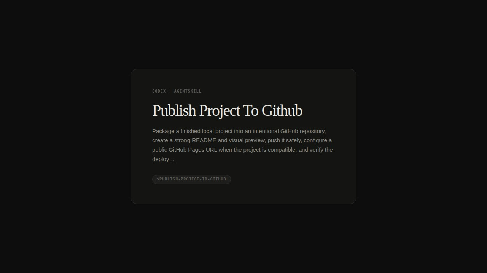

### stitched-full-page-capture

Capture or repair reliable full-page screenshots for lazy-loaded, scroll-animated, Framer, WebGL/canvas, or reveal-heavy web pages. Use when full-page screenshots are blank, gray, white, sparse, show a tiny content strip, disagree with a working scroll video, or when article evidence/section crops must be derived from a trustworthy full-page image.

[Open demo](agent-skills/codex/stitched-full-page-capture/demo/index.html) · [Skill](agent-skills/codex/stitched-full-page-capture/SKILL.md) · [Prompt](agent-skills/codex/stitched-full-page-capture/demo/PROMPT.md) · Local demo

### video-to-superprompt

Turn a reference video into a super detailed recreation or inspiration prompt. Use when the user provides, mentions, uploads, links, or points to a video and asks to analyze the design, UI, animations, transitions, scroll interactions, typography, colors, assets, WebGL/Three.js, storytelling, section-by-section behavior, or to create a prompt/article that recreates the page, app, interaction, or motion system.

[Open demo](agent-skills/codex/video-to-superprompt/demo/index.html) · [Skill](agent-skills/codex/video-to-superprompt/SKILL.md) · [Prompt](agent-skills/codex/video-to-superprompt/demo/PROMPT.md) · Local demo

### web-technique-to-skill

Turn a visual or interaction technique you already built into a reusable web-design skill, by isolating the one mechanism that makes it work while reproducing its approved reference exactly around that focus, and packaging it with a demo that proves both the mechanism and the visual fidelity. Covers finding the mechanism, naming the technique plainly, disclosing the verified runtime and renderer, auditing reference layers, carrying real numbers instead of adjectives, preserving owned staging, keeping expensive gotchas, declaring the boundary against neighbouring skills, and browser-verifying before claiming it works. Use when a page, canvas scene, shader, scroll effect, layout system, or hover interaction turned out well and should become a skill rather than staying in one project.

[Open demo](agent-skills/codex/web-technique-to-skill/demo/index.html) · [Skill](agent-skills/codex/web-technique-to-skill/SKILL.md) · [Prompt](agent-skills/codex/web-technique-to-skill/demo/PROMPT.md) · Local demo

### write-like-meng-on-x

Write, rewrite, review, or continuously refine X/Twitter posts in Meng To's current voice using his deduplicated authored-post corpus, personal and product context, shared resources, and Content repo evidence. Use when asked to improve a tweet in Meng's tone, draft an original post, reply, thread, resource share, or quote post as Meng, check whether an angle repeats an earlier post, study Meng's writing style, ingest another 20-50 authored posts, or hone the reusable Meng X voice profile.

[Open demo](agent-skills/codex/write-like-meng-on-x/demo/index.html) · [Skill](agent-skills/codex/write-like-meng-on-x/SKILL.md) · [Prompt](agent-skills/codex/write-like-meng-on-x/demo/PROMPT.md) · Local demo

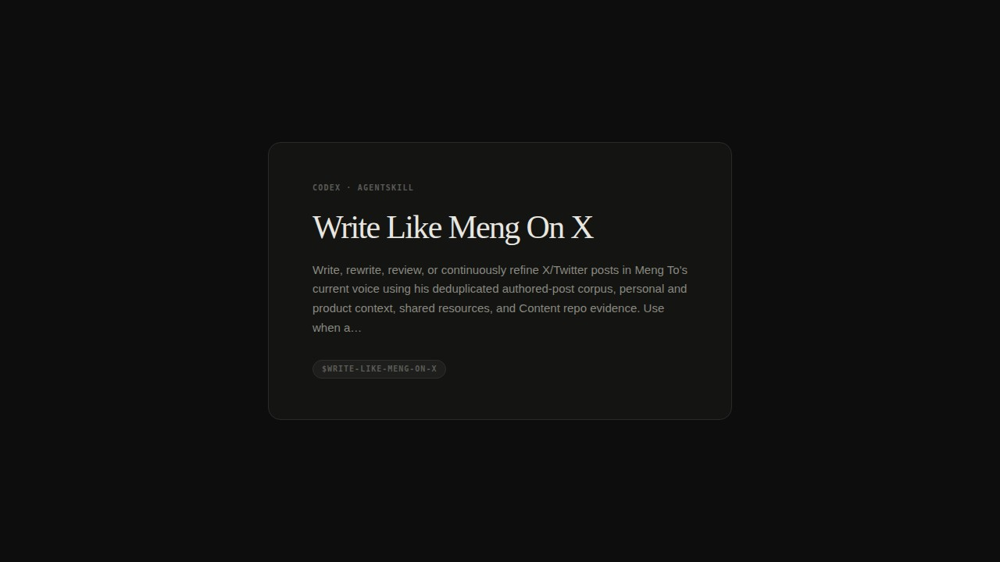

### x-bookmark-quote-posts

Check a user's latest X/Twitter bookmarks and turn recent saved posts into source-backed quote-post drafts calibrated against the user's latest 100 authored posts. Use when asked to review X bookmarks, create quote posts from bookmarks, refresh a bookmark quote queue, run a bookmark quote automation, study a user's X voice, or write first-person quote posts from X sources.

[Open demo](agent-skills/codex/x-bookmark-quote-posts/demo/index.html) · [Skill](agent-skills/codex/x-bookmark-quote-posts/SKILL.md) · [Prompt](agent-skills/codex/x-bookmark-quote-posts/demo/PROMPT.md) · Local demo

## game-development (20)

### author-game-levels

Author or revise readable, flat-world Three.js game levels. Use for movement and camera routes, collision and navigation, encounter zones, landmarks, objectives, pickups, motivated lighting, visibility, deterministic level data, or desktop and mobile playthrough verification.

[Open demo](agent-skills/game-development/author-game-levels/demo/index.html) · [Skill](agent-skills/game-development/author-game-levels/SKILL.md) · [Prompt](agent-skills/game-development/author-game-levels/demo/PROMPT.md) · Local demo

### build-game-audio-feedback

Design or implement responsive audio feedback for a Three.js or web game. Use for action sounds, combat layers, music states, spatial audio, mix priorities, mute controls, accessibility, mobile audio unlock, and audio performance.

[Open demo](agent-skills/game-development/build-game-audio-feedback/demo/index.html) · [Skill](agent-skills/game-development/build-game-audio-feedback/SKILL.md) · [Prompt](agent-skills/game-development/build-game-audio-feedback/demo/PROMPT.md) · Local demo

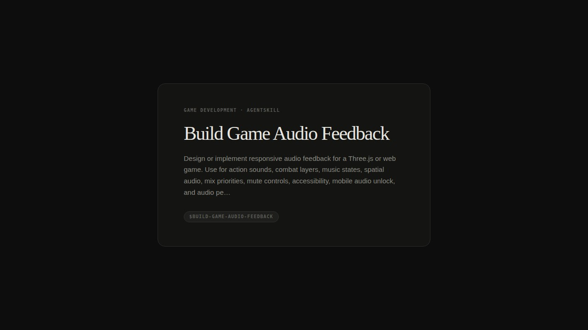

### build-game-camera-controls

Implement or tune Three.js game cameras. Use for isometric framing, follow behavior, orbit/zoom limits, occlusion, lock-on, camera shake, touch camera controls, and camera regression tests.

[Open demo](agent-skills/game-development/build-game-camera-controls/demo/index.html) · [Skill](agent-skills/game-development/build-game-camera-controls/SKILL.md) · [Prompt](agent-skills/game-development/build-game-camera-controls/demo/PROMPT.md) · Local demo

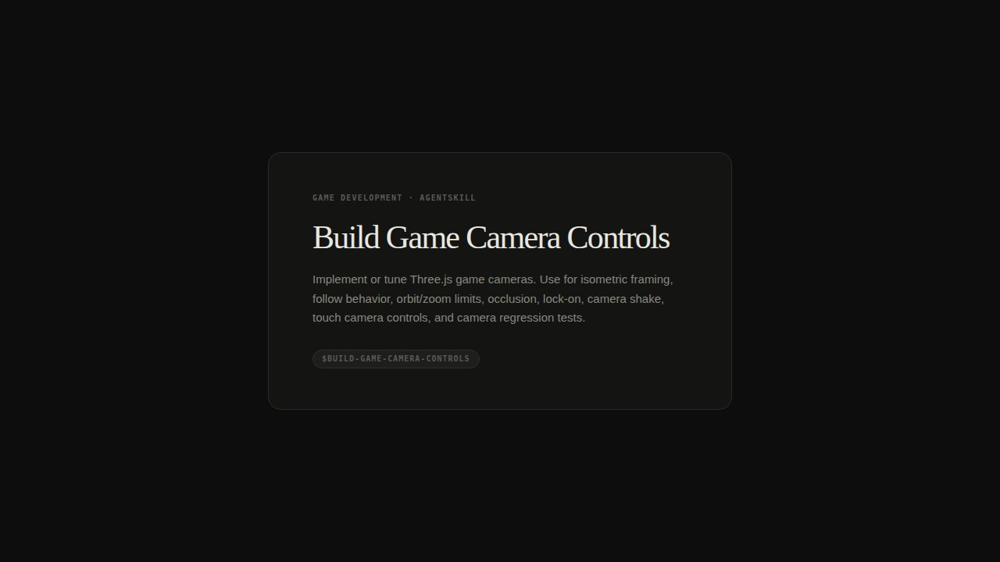

### build-game-changelog

Design, implement, backfill, audit, and release in-game changelogs with contiguous versioning, deployment provenance, menu-state navigation, accessible toggle, close, and Escape behavior, and responsive release-ledger UI. Use when Codex needs to add or revise a changelog or version screen in a game, reconstruct release history from deployments and Git, define version-bump rules, keep displayed versions synchronized with live builds, or test changelog mechanics across desktop and mobile.

[Open demo](agent-skills/game-development/build-game-changelog/demo/index.html) · [Skill](agent-skills/game-development/build-game-changelog/SKILL.md) · [Prompt](agent-skills/game-development/build-game-changelog/demo/PROMPT.md) · Local demo

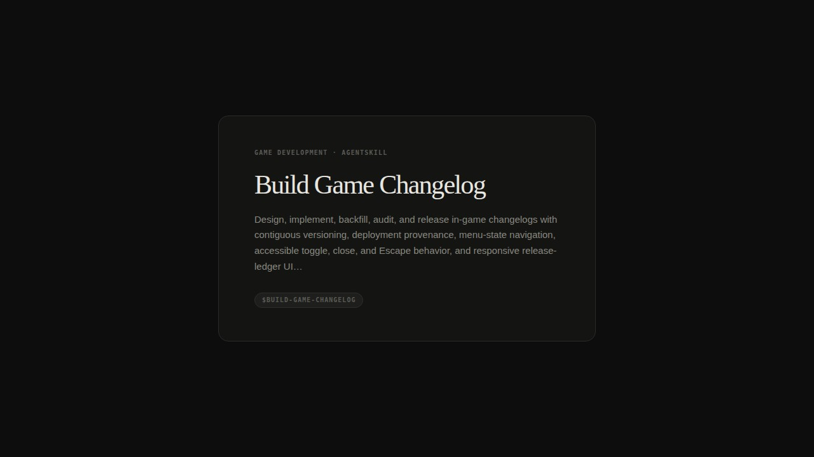

### build-game-inventory

Build or repair game inventory, loot, equipment, tooltips, drag-and-drop, persistence, and progression systems. Use for item schemas, pickup flows, stack rules, equipment slots, atomic swaps, save migration, and no-loss regression testing.

[Open demo](agent-skills/game-development/build-game-inventory/demo/index.html) · [Skill](agent-skills/game-development/build-game-inventory/SKILL.md) · [Prompt](agent-skills/game-development/build-game-inventory/demo/PROMPT.md) · Local demo

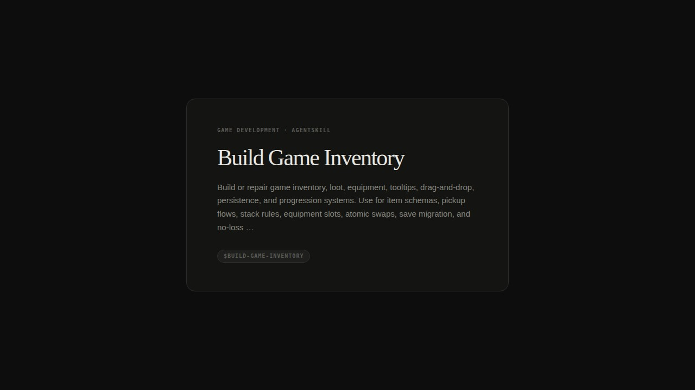

### build-game-map-editor

Build, extend, or audit production-linked browser map editors for Three.js and isometric games. Use when Codex needs to create a private director view, derive a versioned editor document from authored placements, add outliner, layer, selection, drag, snap, inspector, or camera controls, expose enemy aggro, leash, or patrol overlays, implement local draft import, export, undo, and reset, secure an editor route with IP and password sessions, or validate and release a map editor without mutating live gameplay data.

[Open demo](agent-skills/game-development/build-game-map-editor/demo/index.html) · [Skill](agent-skills/game-development/build-game-map-editor/SKILL.md) · [Prompt](agent-skills/game-development/build-game-map-editor/demo/PROMPT.md) · Local demo

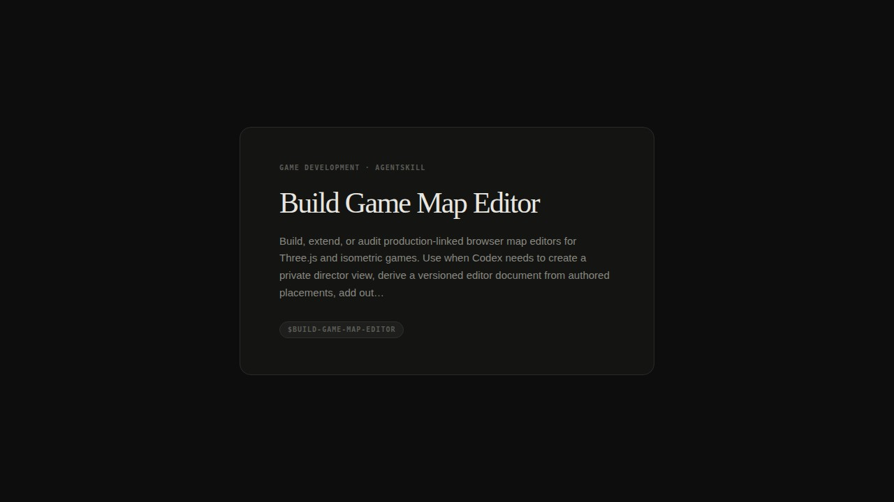

### build-game-monster-system

Build, integrate, audit, or refactor rigged monsters for Three.js and web action games. Use for monster asset contracts, procedural or imported creature rigs, semantic joints and sockets, hurtboxes and attack volumes, combat animation states, enemy-runtime adapters, LODs, deterministic review fixtures, and validating that every monster follows one shared system.

[Open demo](agent-skills/game-development/build-game-monster-system/demo/index.html) · [Skill](agent-skills/game-development/build-game-monster-system/SKILL.md) · [Prompt](agent-skills/game-development/build-game-monster-system/demo/PROMPT.md) · Local demo

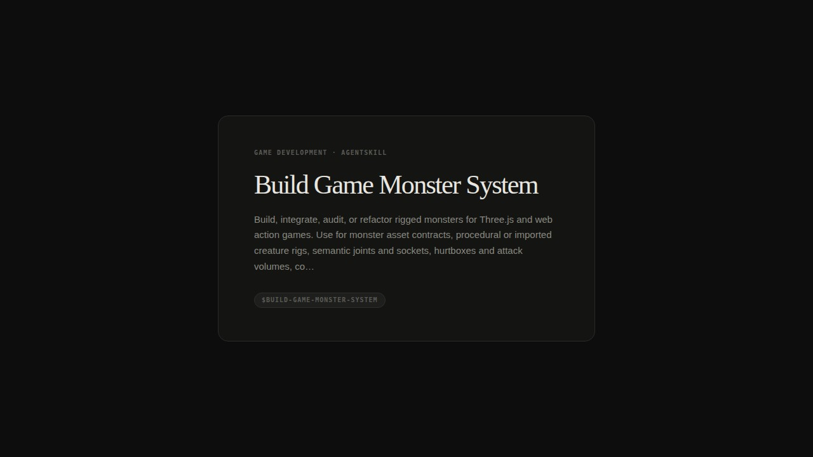

### build-hybrid-game-assets

Plan, create, integrate, or audit a hybrid asset pipeline for a Three.js or web game. Use when choosing among imported meshes, procedural 3D geometry, AI-generated reference art, 2D UI media, sprites, VFX, and performance-ready runtime asset delivery.

[Open demo](agent-skills/game-development/build-hybrid-game-assets/demo/index.html) · [Skill](agent-skills/game-development/build-hybrid-game-assets/SKILL.md) · [Prompt](agent-skills/game-development/build-hybrid-game-assets/demo/PROMPT.md) · Local demo

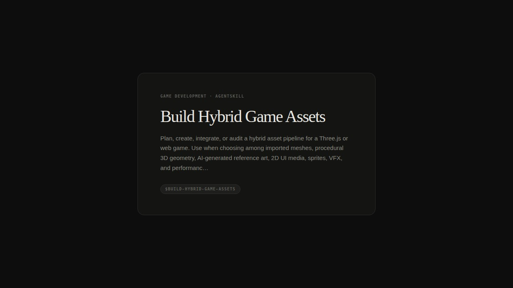

### build-isometric-arpg

Build or extend a playable isometric action RPG in Three.js, React, or similar web technology. Use for game-loop architecture, camera and movement, zones, combat integration, content data, progression, saves, or production-ready vertical slices.

[Open demo](agent-skills/game-development/build-isometric-arpg/demo/index.html) · [Skill](agent-skills/game-development/build-isometric-arpg/SKILL.md) · [Prompt](agent-skills/game-development/build-isometric-arpg/demo/PROMPT.md) · Local demo

### build-mobile-threejs-games

Build, tune, or test a Three.js game for mobile web. Use for touch movement, action controls, target selection, touch inventory, safe areas, portrait/landscape layouts, responsive HUD, battery/performance budgets, and real mobile browser QA.

[Open demo](agent-skills/game-development/build-mobile-threejs-games/demo/index.html) · [Skill](agent-skills/game-development/build-mobile-threejs-games/SKILL.md) · [Prompt](agent-skills/game-development/build-mobile-threejs-games/demo/PROMPT.md) · Local demo

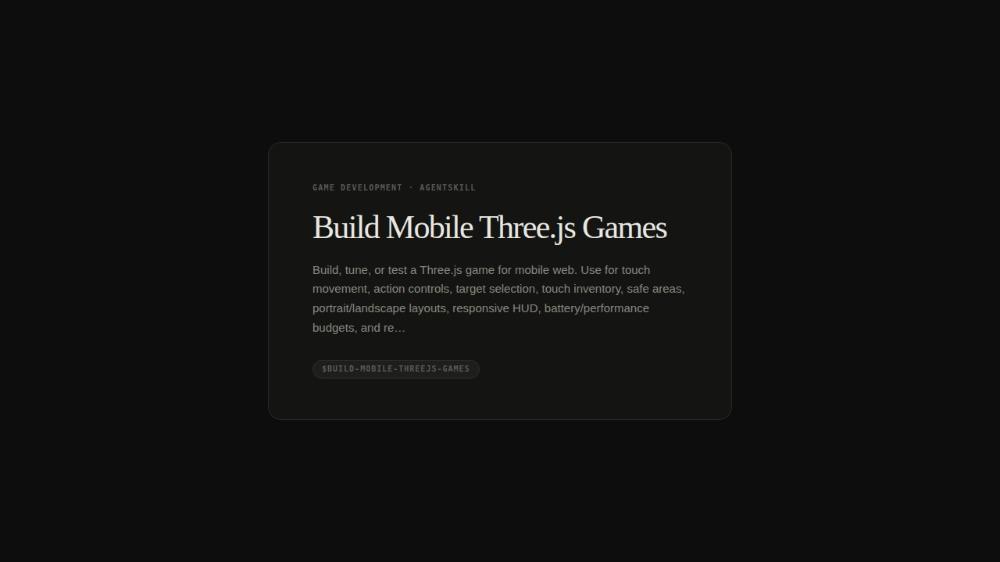

### build-rigged-game-assets

Create, integrate, or audit production-ready rigged 3D characters and monsters with a main model, skeleton, animation library, sockets, collision contracts, separate character equipment, optimized runtime files, catalog media, and an interactive moveset inspector. Use when generating or importing FBX/GLB game actors; defining character-versus-monster asset requirements; separating swords, shields, helmets, armor, or stowed gear; adding idle, walk, run, attack, hit, dodge, block, cast, or death clips; wiring an asset into gameplay; or adding action and equipment controls plus deterministic tests to a game asset catalog.

[Open demo](agent-skills/game-development/build-rigged-game-assets/demo/index.html) · [Skill](agent-skills/game-development/build-rigged-game-assets/SKILL.md) · [Prompt](agent-skills/game-development/build-rigged-game-assets/demo/PROMPT.md) · Local demo

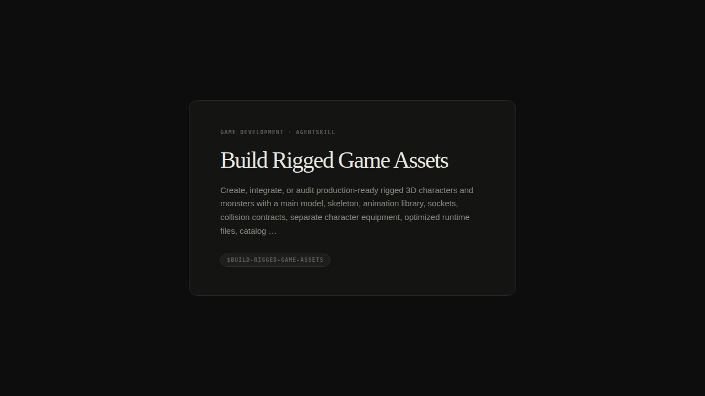

### build-threejs-enemy-systems

Build or refactor reusable, data-driven enemy archetype and moveset systems for Three.js action games. Use for enemy content schemas, model and rig conventions, combat move timing and contact contracts, runtime state boundaries, placeholder fallbacks, deterministic fixtures, or production playthrough validation.

[Open demo](agent-skills/game-development/build-threejs-enemy-systems/demo/index.html) · [Skill](agent-skills/game-development/build-threejs-enemy-systems/SKILL.md) · [Prompt](agent-skills/game-development/build-threejs-enemy-systems/demo/PROMPT.md) · Local demo

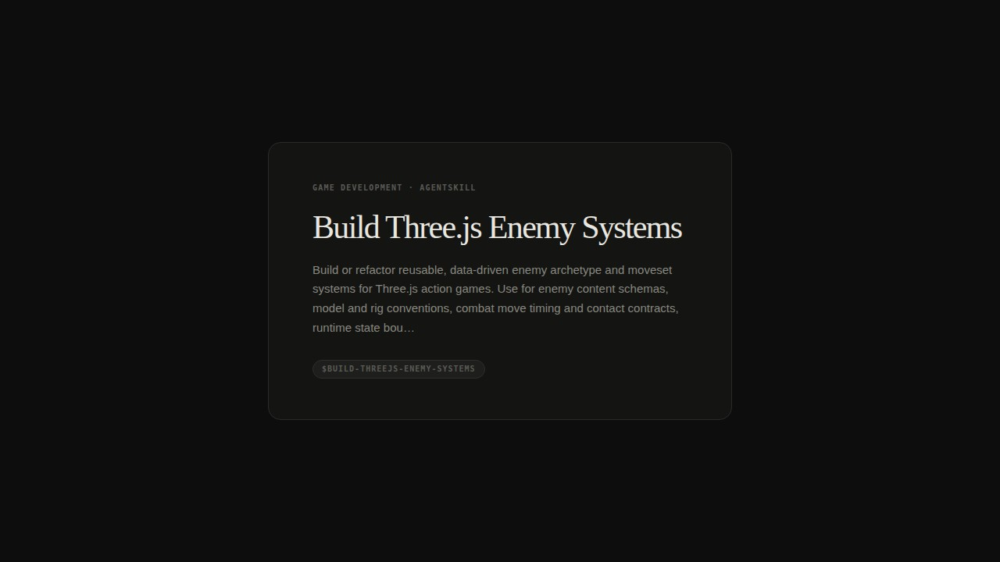

### build-vesperfall-review-assets

Build truthful Vesperfall asset-library review pairs from transparent PNG references and live Three.js, FBX, or img2threejs models. Use when adding a character, enemy, prop, or equipment asset to the Vesperfall catalog; creating a card-PNG plus inspector-model treatment; exposing an isolated model or moveset route; or standardizing provenance, grounding, tests, and Codex-browser validation for game art review.

[Open demo](agent-skills/game-development/build-vesperfall-review-assets/demo/index.html) · [Skill](agent-skills/game-development/build-vesperfall-review-assets/SKILL.md) · [Prompt](agent-skills/game-development/build-vesperfall-review-assets/demo/PROMPT.md) · Local demo

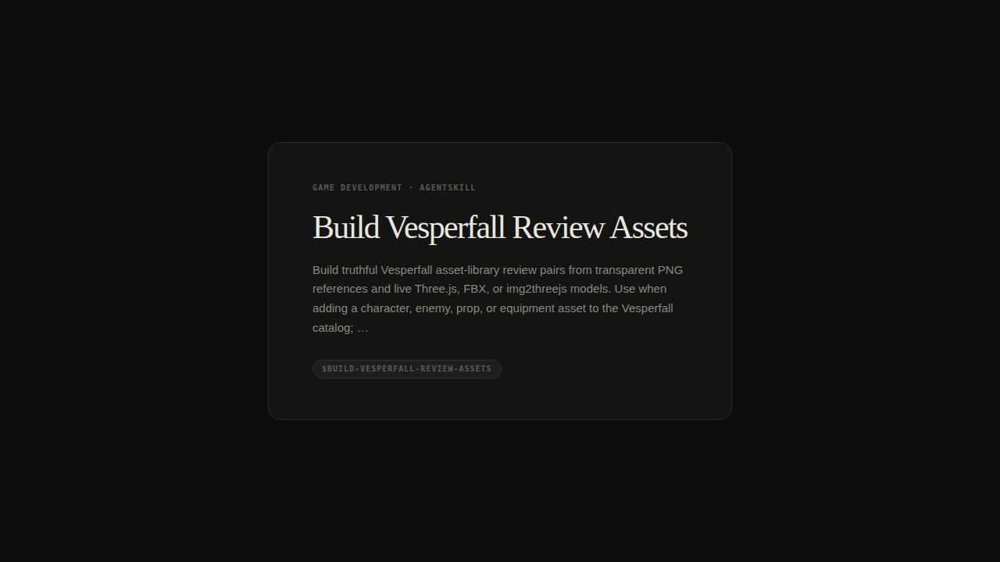

### create-game-vfx

Create readable, performance-safe Three.js game visual effects. Use for attacks, impacts, damage feedback, status effects, spell trails, particles, shaders, telegraphs, quality tiers, and reduced-motion alternatives.

[Open demo](agent-skills/game-development/create-game-vfx/demo/index.html) · [Skill](agent-skills/game-development/create-game-vfx/SKILL.md) · [Prompt](agent-skills/game-development/create-game-vfx/demo/PROMPT.md) · Local demo

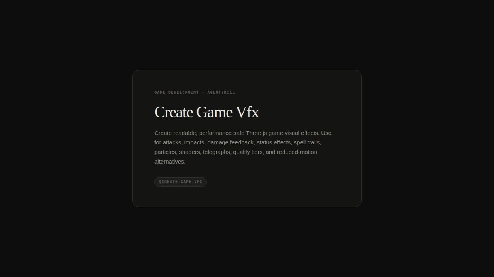

### design-action-combat

Design, implement, tune, or test readable tactical action combat for web games. Use for attack timing, guard and dodge windows, hit contact, posture, lock-on, weapons, boss phases, combat feedback, and deterministic combat tests.

[Open demo](agent-skills/game-development/design-action-combat/demo/index.html) · [Skill](agent-skills/game-development/design-action-combat/SKILL.md) · [Prompt](agent-skills/game-development/design-action-combat/demo/PROMPT.md) · Local demo

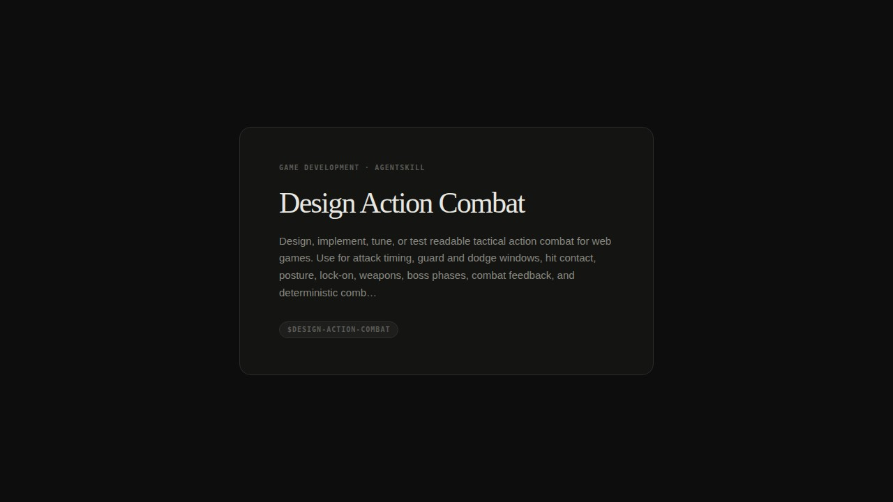

### design-game-encounters

Design, implement, tune, or test Three.js action-game encounters. Use for arena layout, enemy composition, spawn pacing, objectives, boss phases, reward cadence, encounter fixtures, and difficulty validation.

[Open demo](agent-skills/game-development/design-game-encounters/demo/index.html) · [Skill](agent-skills/game-development/design-game-encounters/SKILL.md) · [Prompt](agent-skills/game-development/design-game-encounters/demo/PROMPT.md) · Local demo

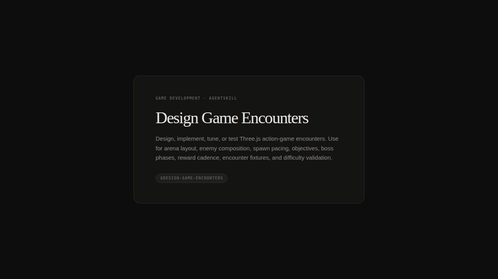

### optimize-threejs-games

Profile, diagnose, and improve Three.js or WebGL game performance without regressing gameplay. Use for frame-time drops, CPU/GPU pressure, draw calls, texture and geometry budgets, animation loops, adaptive quality, mobile performance, and browser performance verification.

[Open demo](agent-skills/game-development/optimize-threejs-games/demo/index.html) · [Skill](agent-skills/game-development/optimize-threejs-games/SKILL.md) · [Prompt](agent-skills/game-development/optimize-threejs-games/demo/PROMPT.md) · Local demo

### ship-web-games

Package, deploy, and verify a playable Three.js or web game. Use for release builds, asset delivery, private/public deployment, production smoke tests, browser proof, release notes, rollback readiness, and cleanup of temporary QA resources.

[Open demo](agent-skills/game-development/ship-web-games/demo/index.html) · [Skill](agent-skills/game-development/ship-web-games/SKILL.md) · [Prompt](agent-skills/game-development/ship-web-games/demo/PROMPT.md) · Local demo

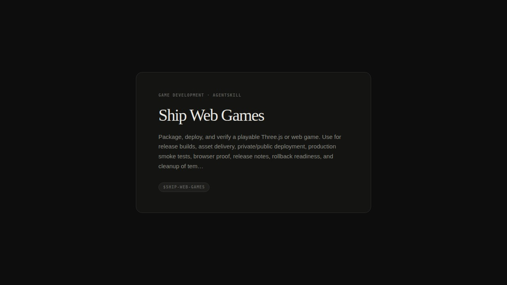

### test-playable-web-games

Test a playable browser game end to end with deterministic fixtures and real browser evidence. Use for gameplay QA, regression testing, controls, accessibility, responsive/mobile testing, save flows, console checks, performance smoke tests, and release verification.

[Open demo](agent-skills/game-development/test-playable-web-games/demo/index.html) · [Skill](agent-skills/game-development/test-playable-web-games/SKILL.md) · [Prompt](agent-skills/game-development/test-playable-web-games/demo/PROMPT.md) · Local demo

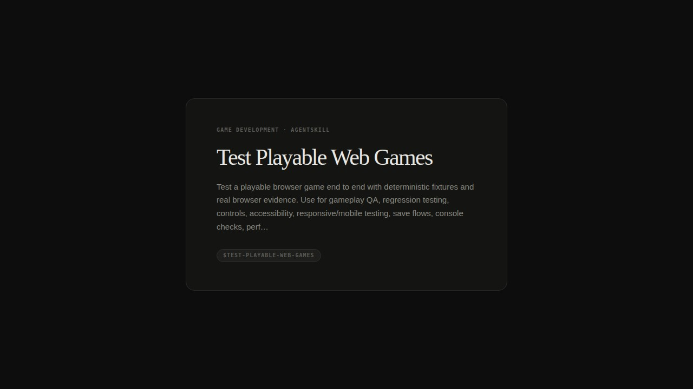

### tune-enemy-ai

Build, debug, balance, or test combat enemy AI for playable action games. Use for aggro, target selection, navigation, spacing, attack choices, telegraphs, retreats, boss behavior, behavior-state machines, and deterministic AI regression tests.

[Open demo](agent-skills/game-development/tune-enemy-ai/demo/index.html) · [Skill](agent-skills/game-development/tune-enemy-ai/SKILL.md) · [Prompt](agent-skills/game-development/tune-enemy-ai/demo/PROMPT.md) · Local demo

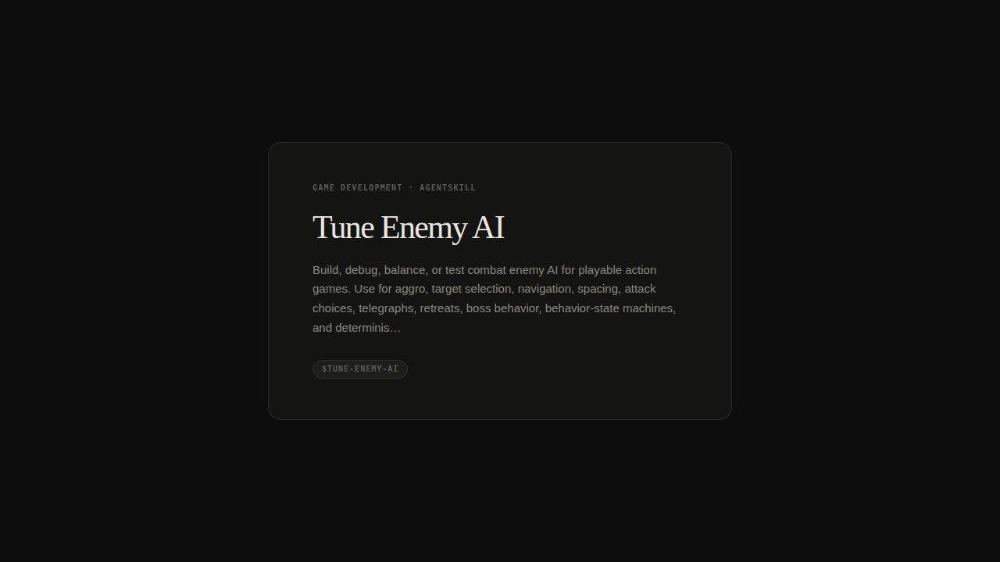

## media (2)

### aura-asset-images

Use when you need high-quality stock-style images from Aura Assets (aura.build/assets) similar to Unsplash for design mockups and marketing: backgrounds, abstract wallpapers, architecture, portraits, and headshots. Includes a workflow for searching by tag on aura.build/assets and returns 5 real image URLs per category plus practical guidance for using different resolutions and aspect ratios.

[Open demo](agent-skills/media/aura-asset-images/demo/index.html) · [Skill](agent-skills/media/aura-asset-images/SKILL.md) · [Prompt](agent-skills/media/aura-asset-images/demo/PROMPT.md) · Neuform #1 · 2,154 views

### unsplash-asset-images

Use when you need to pick high-quality Unsplash images for product/design assets (avatars, headshots, portraits, large website backgrounds, and abstract wallpapers) and output real Unsplash URLs plus practical instructions for producing the right resolutions and aspect ratios (1:1, 4:5, 3:4, 16:9, 9:16).

[Open demo](agent-skills/media/unsplash-asset-images/demo/index.html) · [Skill](agent-skills/media/unsplash-asset-images/SKILL.md) · [Prompt](agent-skills/media/unsplash-asset-images/demo/PROMPT.md) · Local demo

## ui (3)

### audit-ai-design-slop

Audit websites, apps, screenshots, mockups, and design code for harmful AI-design clichés, generic generated defaults, and established UI defects. Use when the user wants evidence-backed design feedback, an anti-slop review, or a removal-first cleanup plan without a speculative redesign.

[Open demo](agent-skills/ui/audit-ai-design-slop/demo/index.html) · [Skill](agent-skills/ui/audit-ai-design-slop/SKILL.md) · [Prompt](agent-skills/ui/audit-ai-design-slop/demo/PROMPT.md) · Local demo

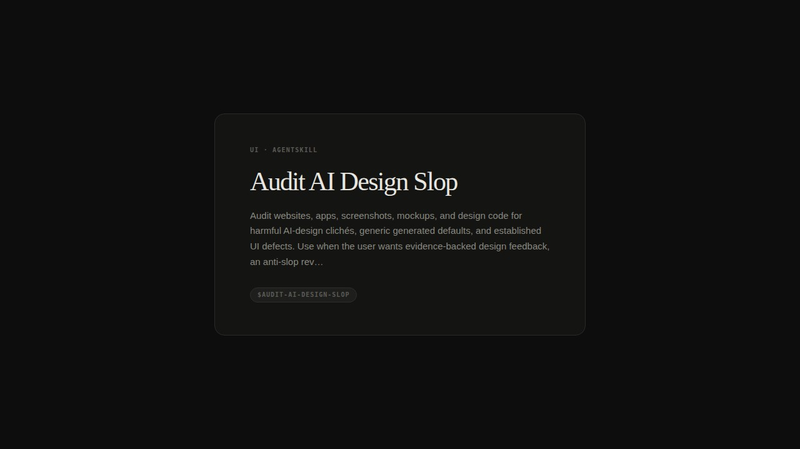

### design-first-ui-prompting

Use when you need design-first, spec-driven, skimmable prompts for UI generation. Covers prompt structure, constraints, variations, typography/spacing rules, and iteration workflow for consistent UI outputs.

[Open demo](agent-skills/ui/design-first-ui-prompting/demo/index.html) · [Skill](agent-skills/ui/design-first-ui-prompting/SKILL.md) · [Prompt](agent-skills/ui/design-first-ui-prompting/demo/PROMPT.md) · Local demo

### no-ai-design-slop

Prevent and remove generic AI-generated design defaults, incoherent visual choices, and established UI defects while creating, revising, or reviewing websites, apps, screenshots, mockups, and design code. Use as a passive quality gate during UI work or for an explicit anti-slop cleanup; preserve the chosen art direction instead of forcing a neutral redesign.

[Open demo](agent-skills/ui/no-ai-design-slop/demo/index.html) · [Skill](agent-skills/ui/no-ai-design-slop/SKILL.md) · [Prompt](agent-skills/ui/no-ai-design-slop/demo/PROMPT.md) · Local demo

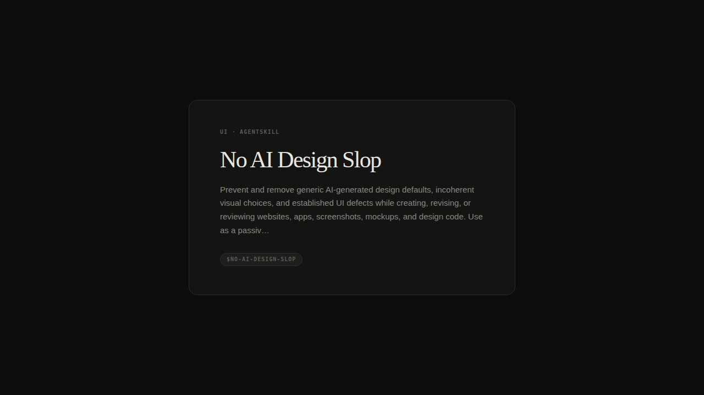

## web-design (88)

### add-mouse-driven-orbit

Add restrained mouse-driven orbit and parallax depth to a Three.js hero by damping one pointer target and splitting it across camera translation, look-at, and small object rotations. Use for passive cinematic 3D heroes, pointer-responsive scenes, organic model parallax, and interactive depth where OrbitControls would feel like a product viewer.

[Open demo](agent-skills/web-design/add-mouse-driven-orbit/demo/index.html) · [Skill](agent-skills/web-design/add-mouse-driven-orbit/SKILL.md) · [Prompt](agent-skills/web-design/add-mouse-driven-orbit/demo/PROMPT.md) · Local demo

### add-shader-cursor-trail

Add the Shaders WebGPU mouse effect used for the Tidal Commons hero: a white twinkling halftone cursor trail driven by ChromaFlow, masked through a DotGrid, finished with chromatic ripples and film grain, and protected by static, touch, accessibility, SSR, and performance fallbacks. Use when a user asks for this shader mouse effect, a halftone cursor trail, an interactive WebGPU hero/contact background, or a reusable cursor-following shader layer in React, Next.js, Vue, Svelte, Solid, or plain web projects.

[Open demo](agent-skills/web-design/add-shader-cursor-trail/demo/index.html) · [Skill](agent-skills/web-design/add-shader-cursor-trail/SKILL.md) · [Prompt](agent-skills/web-design/add-shader-cursor-trail/demo/PROMPT.md) · Local demo

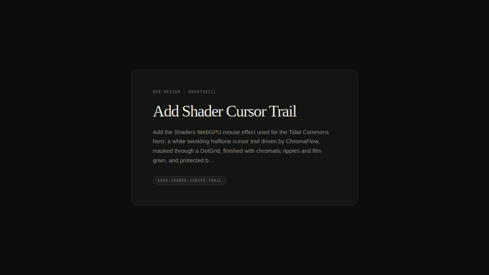

### agency-grid-layout-minimal

Create a minimal agency design system with a disciplined editorial grid, oversized typography, quiet uppercase utility labels, restrained image blocks, and subtle structural detail.

[Open demo](agent-skills/web-design/agency-grid-layout-minimal/demo/index.html) · [Skill](agent-skills/web-design/agency-grid-layout-minimal/SKILL.md) · [Prompt](agent-skills/web-design/agency-grid-layout-minimal/demo/PROMPT.md) · Neuform #1 · 731 views

### ambient-section-particles

Add a restrained particle atmosphere inside one section with configurable shapes, density, gravity, wind, sway, rotation, recycling or settling, pointer disturbance, visibility pausing, responsive limits, and reduced-motion fallbacks. Use for petals, leaves, snow, sparks, confetti, dots, paper, icons, or brand fragments that support a section's mood without obscuring content.

[Open demo](agent-skills/web-design/ambient-section-particles/demo/index.html) · [Skill](agent-skills/web-design/ambient-section-particles/SKILL.md) · [Prompt](agent-skills/web-design/ambient-section-particles/demo/PROMPT.md) · Local demo

### animation-on-scroll

Create an on-scroll animation trigger using IntersectionObserver with Tailwind-friendly animation classes and keyframes. Use when asked for scroll-reveal, animate-on-scroll, or sequencing element animations when they enter the viewport.

[Open demo](agent-skills/web-design/animation-on-scroll/demo/index.html) · [Skill](agent-skills/web-design/animation-on-scroll/SKILL.md) · [Prompt](agent-skills/web-design/animation-on-scroll/demo/PROMPT.md) · Local demo

### animation-systems

Use when designing or implementing product-grade web motion like Stripe, Linear, Apple, and Vercel. Covers motion principles, easing/duration defaults, choreography patterns, scroll/hover interactions, performance, accessibility (reduced motion), and implementation guidance.

[Open demo](agent-skills/web-design/animation-systems/demo/index.html) · [Skill](agent-skills/web-design/animation-systems/SKILL.md) · [Prompt](agent-skills/web-design/animation-systems/demo/PROMPT.md) · Local demo

### atmosphere-background

Create a dark atmospheric background with drifting vertical light folds, screen-blended glow, and a concentrated luminous corner or lower-edge bloom.

[Open demo](agent-skills/web-design/atmosphere-background/demo/index.html) · [Skill](agent-skills/web-design/atmosphere-background/SKILL.md) · [Prompt](agent-skills/web-design/atmosphere-background/demo/PROMPT.md) · Local demo

### background-grid-webgl

Create a perspective WebGL background grid with fading lines, subtle particle haze, slow forward drift, and gentle camera parallax.

[Open demo](agent-skills/web-design/background-grid-webgl/demo/index.html) · [Skill](agent-skills/web-design/background-grid-webgl/SKILL.md) · [Prompt](agent-skills/web-design/background-grid-webgl/demo/PROMPT.md) · Neuform #1 · 351 views

### beam-glow-states

Create React loading, processing, selected, current, focus, and pressed states with the border-beam package's animated edge glow. Use when a card, button, input, tab, option, task panel, or agent surface needs a restrained traveling or breathing beam; includes installation, imports, prop selection, state wiring, reduced motion, accessibility, and performance and layout guardrails.

[Open demo](agent-skills/web-design/beam-glow-states/demo/index.html) · [Skill](agent-skills/web-design/beam-glow-states/SKILL.md) · [Prompt](agent-skills/web-design/beam-glow-states/demo/PROMPT.md) · Local demo

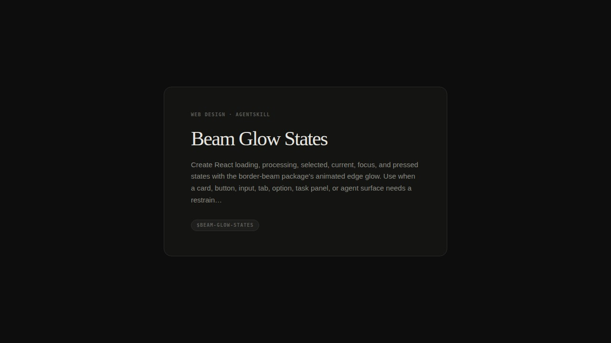

### beautiful-shadows

Apply exact Tailwind arbitrary shadow utilities for polished, layered neutral elevation. Use when compact cards, controls, panels, popovers, hero media, feature callouts, or modal-like containers need refined shadows without default Tailwind shadow scales or colored tinting.

[Open demo](agent-skills/web-design/beautiful-shadows/demo/index.html) · [Skill](agent-skills/web-design/beautiful-shadows/SKILL.md) · [Prompt](agent-skills/web-design/beautiful-shadows/demo/PROMPT.md) · Neuform #1 · 1,953 views

### blue-cloudy-clean-modern

Create a clean modern design system with a luminous blue sky atmosphere, soft drifting cloud light, minimal white framing, and serene premium typography.

[Open demo](agent-skills/web-design/blue-cloudy-clean-modern/demo/index.html) · [Skill](agent-skills/web-design/blue-cloudy-clean-modern/SKILL.md) · [Prompt](agent-skills/web-design/blue-cloudy-clean-modern/demo/PROMPT.md) · Neuform #1 · 351 views

### blue-laser-clean-glass-layout

Create a clean dark glass layout system with a thin blue laser atmosphere, frosted premium shells, and polished dashboard structure.

[Open demo](agent-skills/web-design/blue-laser-clean-glass-layout/demo/index.html) · [Skill](agent-skills/web-design/blue-laser-clean-glass-layout/SKILL.md) · [Prompt](agent-skills/web-design/blue-laser-clean-glass-layout/demo/PROMPT.md) · Local demo

### book-serif-index

Create an archival book-reader design system with serif-led pages, mono index navigation, aged paper surfaces, margin notes, and a premium catalog frame.

[Open demo](agent-skills/web-design/book-serif-index/demo/index.html) · [Skill](agent-skills/web-design/book-serif-index/SKILL.md) · [Prompt](agent-skills/web-design/book-serif-index/demo/PROMPT.md) · Neuform #1 · 80 views

### bright-green-tech-system-webgl

Create a bright-green technical design system with structured split layouts, hard-framed dark surfaces, mono utility labels, and a prominent WebGL visualization zone.

[Open demo](agent-skills/web-design/bright-green-tech-system-webgl/demo/index.html) · [Skill](agent-skills/web-design/bright-green-tech-system-webgl/SKILL.md) · [Prompt](agent-skills/web-design/bright-green-tech-system-webgl/demo/PROMPT.md) · Local demo

### build-awwwards-quality-sites

Art-direct and implement distinctive, motion-rich marketing, editorial, portfolio, and landing websites with original reference-inspired imagery, standout heroes, GSAP choreography, one smooth-scroll engine, optional Three.js shaders, honest icon and logo sourcing, photo avatars, accessibility, and performance safeguards. Use when a user asks for an Awwwards-quality, premium, cinematic, interactive, high-concept, or motion-led website, or explicitly requests this visual and motion system.

[Open demo](agent-skills/web-design/build-awwwards-quality-sites/demo/index.html) · [Skill](agent-skills/web-design/build-awwwards-quality-sites/SKILL.md) · [Prompt](agent-skills/web-design/build-awwwards-quality-sites/demo/PROMPT.md) · Local demo

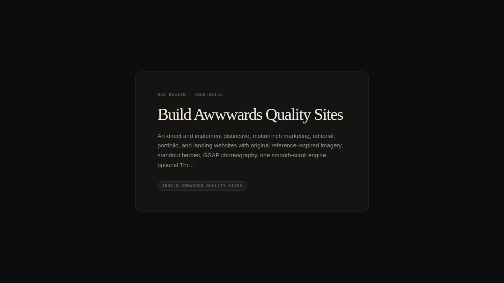

### build-interactive-particle-trail

Build a cursor or touch particle interaction that emits by distance along the traveled segment into a recycled GPU point pool, with optional keyboard-triggered bursts. Use for interactive particle trails, pollen lifted from a surface, dust disturbed by a pointer, hover particle bursts, and discrete motes whose spacing must stay consistent at different gesture speeds.

[Open demo](agent-skills/web-design/build-interactive-particle-trail/demo/index.html) · [Skill](agent-skills/web-design/build-interactive-particle-trail/SKILL.md) · [Prompt](agent-skills/web-design/build-interactive-particle-trail/demo/PROMPT.md) · Local demo

### build-threejs-scroll-worlds

Build rich, scroll-controlled real-time Three.js experiences as one persistent 3D world whose camera, lighting, atmosphere, materials, objects, DOM story, and interactions evolve across authored chapters. Use for 3D scrollytelling, scroll-driven WebGL worlds, camera journeys, interactive portfolios, product stories, exhibitions, explainers, game or film microsites, spatial narratives, and multi-scene websites where native scroll should travel through one continuous place. Not limited to landing pages.

[Open demo](agent-skills/web-design/build-threejs-scroll-worlds/demo/index.html) · [Skill](agent-skills/web-design/build-threejs-scroll-worlds/SKILL.md) · [Prompt](agent-skills/web-design/build-threejs-scroll-worlds/demo/PROMPT.md) · Local demo

### build-wireframe-scan-reveal

Reveal Three.js geometry with an expanding world-space scan whose wire cage leads the solid surface, then burns away. Use for wireframe scanning, radial mesh reveals, survey pulses, holographic assembly, topology intros, and 3D model entrances where a plain opacity wipe does not explain the form.

[Open demo](agent-skills/web-design/build-wireframe-scan-reveal/demo/index.html) · [Skill](agent-skills/web-design/build-wireframe-scan-reveal/SKILL.md) · [Prompt](agent-skills/web-design/build-wireframe-scan-reveal/demo/PROMPT.md) · Local demo

### cinematic-gsap-lenis-motion-system

Create premium cinematic web motion systems with GSAP, ScrollTrigger, and Lenis. Use for luxury editorial websites, creative studio portfolios, Awwwards-style interactions, smooth scroll reveals, staggered text, parallax, pinned sections, magnetic hover states, custom cursors, and mouse-reactive layered movement.

[Open demo](agent-skills/web-design/cinematic-gsap-lenis-motion-system/demo/index.html) · [Skill](agent-skills/web-design/cinematic-gsap-lenis-motion-system/SKILL.md) · [Prompt](agent-skills/web-design/cinematic-gsap-lenis-motion-system/demo/PROMPT.md) · Local demo

### cinematic-scroll-storytelling

Create cinematic scroll-driven landing pages with Lenis smooth scrolling, GSAP ScrollTrigger, scroll-linked progression, staggered text reveals, sticky card stacks, parallax backgrounds, scroll-scrubbed transitions, footer reveals, and immersive preloaders. Use when analyzing or building premium editorial scroll experiences, sticky project stacks, kinetic typography, or section-by-section storytelling.

[Open demo](agent-skills/web-design/cinematic-scroll-storytelling/demo/index.html) · [Skill](agent-skills/web-design/cinematic-scroll-storytelling/SKILL.md) · [Prompt](agent-skills/web-design/cinematic-scroll-storytelling/demo/PROMPT.md) · Local demo

### clean-minimal-beige-light-mode

Create a clean minimal beige light-mode design system with warm neutral shells, quiet process grids, restrained accent color, and elegant low-contrast structure.

[Open demo](agent-skills/web-design/clean-minimal-beige-light-mode/demo/index.html) · [Skill](agent-skills/web-design/clean-minimal-beige-light-mode/SKILL.md) · [Prompt](agent-skills/web-design/clean-minimal-beige-light-mode/demo/PROMPT.md) · Neuform #1 · 744 views

### cobejs

Use when adding a lightweight interactive globe with cobe (canvas setup, markers, interaction, performance, integration with React/Next.js).

[Open demo](agent-skills/web-design/cobejs/demo/index.html) · [Skill](agent-skills/web-design/cobejs/SKILL.md) · [Prompt](agent-skills/web-design/cobejs/demo/PROMPT.md) · Local demo

### company-logos

Use Iconify Simple Icons logos (64x64) instead of text logos.

[Open demo](agent-skills/web-design/company-logos/demo/index.html) · [Skill](agent-skills/web-design/company-logos/SKILL.md) · [Prompt](agent-skills/web-design/company-logos/demo/PROMPT.md) · Neuform #1 · 435 views

### container-lines

Add vertical container-size guide lines with mini corner squares for precise, structured web layouts. Use when asked for container lines, measured layout guides, vertical boundary lines, editorial grid markers, or small corner-square frame details.

[Open demo](agent-skills/web-design/container-lines/demo/index.html) · [Skill](agent-skills/web-design/container-lines/SKILL.md) · [Prompt](agent-skills/web-design/container-lines/demo/PROMPT.md) · Neuform #1 · 2,154 views

### corner-diagonals

Apply diagonal-cut corners and chamfered edges to buttons, cards, panels, and container shells. Use when a design needs precise geometric framing, sci-fi UI surfaces, clipped-corner controls, or engineered sharp containers instead of rounded pills or plain rectangles.

[Open demo](agent-skills/web-design/corner-diagonals/demo/index.html) · [Skill](agent-skills/web-design/corner-diagonals/SKILL.md) · [Prompt](agent-skills/web-design/corner-diagonals/demo/PROMPT.md) · Neuform #1 · 1,953 views

### corner-lasers

Create a corner-anchored laser composition with thin beams, a bright emitter node, bloom, and atmospheric glow or fog.

[Open demo](agent-skills/web-design/corner-lasers/demo/index.html) · [Skill](agent-skills/web-design/corner-lasers/SKILL.md) · [Prompt](agent-skills/web-design/corner-lasers/demo/PROMPT.md) · Neuform #1 · 278 views

### css-alpha-masking

Apply CSS alpha masking with linear-gradient for horizontal or vertical edge fades (mask-image and -webkit-mask-image). Use when asked for alpha masks, fade edges, or CSS mask gradients.

[Open demo](agent-skills/web-design/css-alpha-masking/demo/index.html) · [Skill](agent-skills/web-design/css-alpha-masking/SKILL.md) · [Prompt](agent-skills/web-design/css-alpha-masking/demo/PROMPT.md) · Local demo

### css-border-gradient

Apply subtle gradient-border treatments for premium web surfaces. Use when cards, pricing panels, nav bars, modals, buttons, or hero surfaces need a refined edge highlight without a loud glow.

[Open demo](agent-skills/web-design/css-border-gradient/demo/index.html) · [Skill](agent-skills/web-design/css-border-gradient/SKILL.md) · [Prompt](agent-skills/web-design/css-border-gradient/demo/PROMPT.md) · Neuform #1 · 2,154 views

### dark-blue-contrasting-clean

Create a dark-blue clean design system with strong contrast, cobalt gradient feature blocks, crisp framed structure, and restrained premium glow.

[Open demo](agent-skills/web-design/dark-blue-contrasting-clean/demo/index.html) · [Skill](agent-skills/web-design/dark-blue-contrasting-clean/SKILL.md) · [Prompt](agent-skills/web-design/dark-blue-contrasting-clean/demo/PROMPT.md) · Local demo

### dark-glass-clean-layout

Create a dark glass layout system with frosted premium shells, clean multi-column workspace structure, floating data cards, and restrained atmospheric depth.

[Open demo](agent-skills/web-design/dark-glass-clean-layout/demo/index.html) · [Skill](agent-skills/web-design/dark-glass-clean-layout/SKILL.md) · [Prompt](agent-skills/web-design/dark-glass-clean-layout/demo/PROMPT.md) · Local demo

### dither-background

Create a dark monochrome procedural background with enlarged square pixels and visible Bayer-style ordered dithering. Use when a page needs an atmospheric near-black dither field, broad organic waves or cloud masses, and restrained gray-white highlights behind framed UI, hero content, or data overlays.

[Open demo](agent-skills/web-design/dither-background/demo/index.html) · [Skill](agent-skills/web-design/dither-background/SKILL.md) · [Prompt](agent-skills/web-design/dither-background/demo/PROMPT.md) · Neuform #1 · 1,043 views

### dither-laser-dark-mode

Create a dark premium design system that combines near-black surfaces, subtle ordered-dither texture, and a thin accent-colored laser atmosphere.

[Open demo](agent-skills/web-design/dither-laser-dark-mode/demo/index.html) · [Skill](agent-skills/web-design/dither-laser-dark-mode/SKILL.md) · [Prompt](agent-skills/web-design/dither-laser-dark-mode/demo/PROMPT.md) · Neuform #1 · 322 views

### documentary-brutalist-agency

Create or redesign creative agency, production studio, architecture, culture, and portfolio websites with billboard typography, hard black-and-white chapters, exposed grids, documentary imagery, irregular collages, restrained parallax, brutalist navigation, and accessible FAQ controls.

[Open demo](agent-skills/web-design/documentary-brutalist-agency/demo/index.html) · [Skill](agent-skills/web-design/documentary-brutalist-agency/SKILL.md) · [Prompt](agent-skills/web-design/documentary-brutalist-agency/demo/PROMPT.md) · Local demo

### editorial-portfolio-chapters

Create or redesign creative-studio, agency, photographer, artist, and portfolio websites where project work leads the story. Use for dark editorial shells, full-bleed campaign media, color-coded case-study chapters, oversized service typography, restrained project reveals, and a decisive contact finale.

[Open demo](agent-skills/web-design/editorial-portfolio-chapters/demo/index.html) · [Skill](agent-skills/web-design/editorial-portfolio-chapters/SKILL.md) · [Prompt](agent-skills/web-design/editorial-portfolio-chapters/demo/PROMPT.md) · Local demo

### editorial-service-booking

Create or redesign appointment-based service websites for salons, barbers, spas, wellness studios, clinics, and hospitality brands. Use for warm editorial layouts, serif-led identity, documentary portrait crops, calm treatment selectors, location-aware booking, and operational states that remain elegant and trustworthy.

[Open demo](agent-skills/web-design/editorial-service-booking/demo/index.html) · [Skill](agent-skills/web-design/editorial-service-booking/SKILL.md) · [Prompt](agent-skills/web-design/editorial-service-booking/demo/PROMPT.md) · Local demo

### editorial-tech

Blend editorial magazine composition with precision product-tech detailing using asymmetrical grids, cinematic media bands, mono utility labels, and restrained accent color.

[Open demo](agent-skills/web-design/editorial-tech/demo/index.html) · [Skill](agent-skills/web-design/editorial-tech/SKILL.md) · [Prompt](agent-skills/web-design/editorial-tech/demo/PROMPT.md) · Neuform #1 · 607 views

### falling-leaves

Build falling leaves that read as leaves, with each one tumbling on its own axis so it presents a face, thins to an edge, and opens out again, and with its sideways slip driven by that same tumble. Covers the 2-D canvas build and the instanced-3-D variant, where leaves are recycled from, density-versus-count maths, depth layering, colour under a tone-mapped composite, reduced motion, and visibility pausing. Use for autumn maple, sakura petals, blossom, ash, snowfall shapes, or any drifting foliage where a generic particle field reads as confetti.

[Open demo](agent-skills/web-design/falling-leaves/demo/index.html) · [Skill](agent-skills/web-design/falling-leaves/SKILL.md) · [Prompt](agent-skills/web-design/falling-leaves/demo/PROMPT.md) · Local demo

### framed-grid-layout

Create minimal framed grid layouts with thin visible boundary lines, L-shaped corner brackets, subtle diagonal line texture, and strict section alignment. Use when asked for clean, neutral, precise, structured, editorial, technical, or guide-border web layouts.

[Open demo](agent-skills/web-design/framed-grid-layout/demo/index.html) · [Skill](agent-skills/web-design/framed-grid-layout/SKILL.md) · [Prompt](agent-skills/web-design/framed-grid-layout/demo/PROMPT.md) · Neuform #1 · 1,043 views

### framed-tech-dark-border-gradient

Create a framed dark technical design system with border-gradient shells, asymmetrical grid panels, mono utility labeling, and restrained monochrome atmosphere.

[Open demo](agent-skills/web-design/framed-tech-dark-border-gradient/demo/index.html) · [Skill](agent-skills/web-design/framed-tech-dark-border-gradient/SKILL.md) · [Prompt](agent-skills/web-design/framed-tech-dark-border-gradient/demo/PROMPT.md) · Local demo

### funky-purple-container-tech

Create a dark container-led technical design system with fuchsia-purple accents, layered rounded shells, crisp frame lines, and playful futuristic focal objects.

[Open demo](agent-skills/web-design/funky-purple-container-tech/demo/index.html) · [Skill](agent-skills/web-design/funky-purple-container-tech/SKILL.md) · [Prompt](agent-skills/web-design/funky-purple-container-tech/demo/PROMPT.md) · Local demo

### glass-dark-mode-clock

Create a dark glass design system with frosted shells, soft beam grids, circular clock-like calibration dials, and precise sci-fi instrument framing.

[Open demo](agent-skills/web-design/glass-dark-mode-clock/demo/index.html) · [Skill](agent-skills/web-design/glass-dark-mode-clock/SKILL.md) · [Prompt](agent-skills/web-design/glass-dark-mode-clock/demo/PROMPT.md) · Neuform #1 · 1,043 views

### glass-dark-ui

Build dark-mode glassmorphism interfaces with readable contrast, frosted surfaces, and gradient borders using a pseudo-element mask. Use when asked for glass cards, frosted dark hero sections, blur panels, or dark UI systems with gradient/glow borders.

[Open demo](agent-skills/web-design/glass-dark-ui/demo/index.html) · [Skill](agent-skills/web-design/glass-dark-ui/SKILL.md) · [Prompt](agent-skills/web-design/glass-dark-ui/demo/PROMPT.md) · Local demo

### globe-gl

Use when implementing globe.gl (Globe.GL) for 3D globe data visualization with WebGL/ThreeJS, including setup, data layers (points, arcs, polygons, labels), and integration patterns in plain HTML or React.

[Open demo](agent-skills/web-design/globe-gl/demo/index.html) · [Skill](agent-skills/web-design/globe-gl/SKILL.md) · [Prompt](agent-skills/web-design/globe-gl/demo/PROMPT.md) · Local demo

### globe-particles

Create a globe-like 3D particle visualization with a dense luminous spherical core and thinner orbital ring or flattened disc. Use when a design needs a premium planetary, orbital, synthesized data-globe effect rendered with real WebGL/Three.js particles, not generic starfields or full page layout changes.

[Open demo](agent-skills/web-design/globe-particles/demo/index.html) · [Skill](agent-skills/web-design/globe-particles/SKILL.md) · [Prompt](agent-skills/web-design/globe-particles/demo/PROMPT.md) · Neuform #1 · 607 views

### gooey-blob-system

Create a gooey blob system using SVG filters where multiple shapes merge into a single fluid form. Use overlapping circles combined with a Gaussian blur and color matrix filter to produce a continuous, organic mass. The forms should visually fuse and separate based on proximity. Focus on filter-driven merging (blur + threshold effect), soft organic boundaries with no hard edges, multiple independent shapes behaving as one system, and smooth continuous motion that feels fluid and cohesive.

[Open demo](agent-skills/web-design/gooey-blob-system/demo/index.html) · [Skill](agent-skills/web-design/gooey-blob-system/SKILL.md) · [Prompt](agent-skills/web-design/gooey-blob-system/demo/PROMPT.md) · Neuform #1 · 170 views

### gsap-scrolltrigger-storytelling

Build cinematic sticky product storytelling with GSAP ScrollTrigger, progressive UI reveals, scroll-synced animation, smooth interpolation, and immersive section transitions.

[Open demo](agent-skills/web-design/gsap-scrolltrigger-storytelling/demo/index.html) · [Skill](agent-skills/web-design/gsap-scrolltrigger-storytelling/SKILL.md) · [Prompt](agent-skills/web-design/gsap-scrolltrigger-storytelling/demo/PROMPT.md) · Neuform #1 · 78 views

### gsap

Use when you need to add or debug professional web animations with GSAP (timelines, ScrollTrigger, stagger, transforms) in HTML/CSS/JS/React. Includes patterns for smooth motion, performance, and common pitfalls.

[Open demo](agent-skills/web-design/gsap/demo/index.html) · [Skill](agent-skills/web-design/gsap/SKILL.md) · [Prompt](agent-skills/web-design/gsap/demo/PROMPT.md) · Neuform #1 · 857 views

### high-contrast-skeuomorphic-clean

Create a high-contrast clean skeuomorphic design system with molded dark surfaces, crisp light separation, tactile inset depth, and restrained signal accents.

[Open demo](agent-skills/web-design/high-contrast-skeuomorphic-clean/demo/index.html) · [Skill](agent-skills/web-design/high-contrast-skeuomorphic-clean/SKILL.md) · [Prompt](agent-skills/web-design/high-contrast-skeuomorphic-clean/demo/PROMPT.md) · Neuform #1 · 851 views

### image-first-grid-layout

Create an image-led grid design system with full-bleed photography, structural guide lines, anchored content blocks, and restrained technical overlays.

[Open demo](agent-skills/web-design/image-first-grid-layout/demo/index.html) · [Skill](agent-skills/web-design/image-first-grid-layout/SKILL.md) · [Prompt](agent-skills/web-design/image-first-grid-layout/demo/PROMPT.md) · Neuform #1 · 2,154 views

### landing-page

Use when designing or rewriting a high-converting landing page (single-offer page) for SaaS/apps/services. Covers structure, layout patterns, conversion strategies, copywriting, SEO/AEO, and common pitfalls.

[Open demo](agent-skills/web-design/landing-page/demo/index.html) · [Skill](agent-skills/web-design/landing-page/SKILL.md) · [Prompt](agent-skills/web-design/landing-page/demo/PROMPT.md) · Local demo

### light-mode-paper-technical

Create a light-mode technical design system with warm paper surfaces, dark outer framing, subtle diagonal texture, precise bracketed geometry, and restrained accent signals.

[Open demo](agent-skills/web-design/light-mode-paper-technical/demo/index.html) · [Skill](agent-skills/web-design/light-mode-paper-technical/SKILL.md) · [Prompt](agent-skills/web-design/light-mode-paper-technical/demo/PROMPT.md) · Neuform #1 · 351 views

### liquid-metal-border

Add and tune animated liquid-metal WebGL borders with the React `metal-fx` package. Use when buttons, icon controls, chips, tabs, cards, or selected surfaces need a metallic active, selected, hover, focus, or premium border; when implementing the MetalFx component from metal.jakubantalik.com; or when troubleshooting its presets, themes, strength, glow, reflections, sizing, radius, animation, accessibility, SSR, or performance.

[Open demo](agent-skills/web-design/liquid-metal-border/demo/index.html) · [Skill](agent-skills/web-design/liquid-metal-border/SKILL.md) · [Prompt](agent-skills/web-design/liquid-metal-border/demo/PROMPT.md) · Local demo

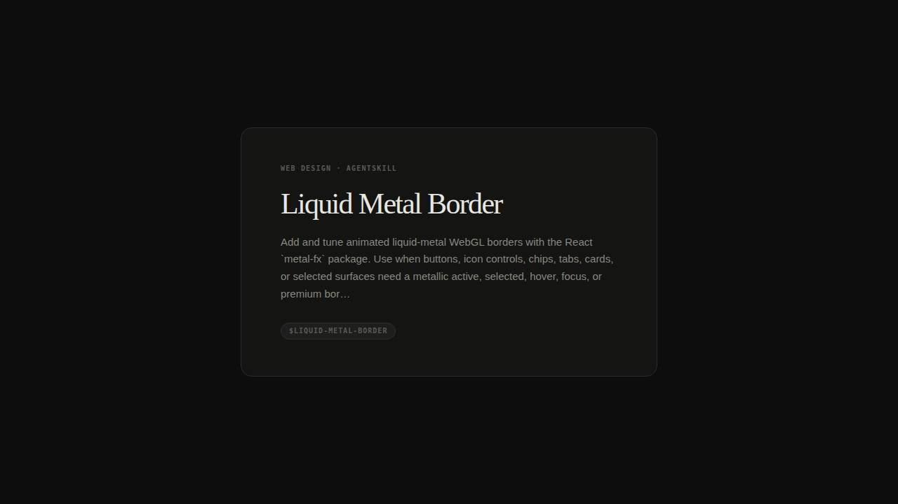

### marquee-loop

Apply seamless infinite marquee loops using duplicated items.

[Open demo](agent-skills/web-design/marquee-loop/demo/index.html) · [Skill](agent-skills/web-design/marquee-loop/SKILL.md) · [Prompt](agent-skills/web-design/marquee-loop/demo/PROMPT.md) · Neuform #1 · 353 views

### masked-reveal

Create masked staggered word reveals on scroll with GSAP ScrollTrigger. Use when headings, hero copy, section titles, or editorial text should reveal word-by-word through an overflow mask as they enter the viewport.

[Open demo](agent-skills/web-design/masked-reveal/demo/index.html) · [Skill](agent-skills/web-design/masked-reveal/SKILL.md) · [Prompt](agent-skills/web-design/masked-reveal/demo/PROMPT.md) · Neuform #1 · 2,154 views

### matterjs

Use when implementing 2D physics interactions with Matter.js, including Engine/World setup, Render/Runner configuration, adding bodies and constraints, and scroll/interaction-friendly canvas scenes.

[Open demo](agent-skills/web-design/matterjs/demo/index.html) · [Skill](agent-skills/web-design/matterjs/SKILL.md) · [Prompt](agent-skills/web-design/matterjs/demo/PROMPT.md) · Local demo

### mesh-gradient-dark-blue-clean

Create a futuristic, premium, clean dark-blue mesh-gradient design system across background rendering, hero shell, navigation, floating nodes, framed sections, CTAs, and motion. Use when the interface needs a near-black navy foundation, procedural blue mesh atmosphere, disciplined minimal structure, and infrastructural or planetary depth.

[Open demo](agent-skills/web-design/mesh-gradient-dark-blue-clean/demo/index.html) · [Skill](agent-skills/web-design/mesh-gradient-dark-blue-clean/SKILL.md) · [Prompt](agent-skills/web-design/mesh-gradient-dark-blue-clean/demo/PROMPT.md) · Neuform #1 · 1,043 views

### nested-container-clean-agency

Create a clean agency design system built from nested containers, with an outer editorial shell, inset dark feature blocks, rounded premium cards, and restrained accent color.

[Open demo](agent-skills/web-design/nested-container-clean-agency/demo/index.html) · [Skill](agent-skills/web-design/nested-container-clean-agency/SKILL.md) · [Prompt](agent-skills/web-design/nested-container-clean-agency/demo/PROMPT.md) · Neuform #1 · 351 views

### nested-container-frames

Create a container-in-container layout system using nested frames. Use an outer centered container with visible vertical boundary lines and corner markers. Inside, place inner containers inset from the edges, each with its own background and rounded frame. Technique: outer container defines global bounds, inner containers use padding to create inset spacing, layered frames (border + background) to separate levels, and consistent spacing between outer frame and inner blocks.

[Open demo](agent-skills/web-design/nested-container-frames/demo/index.html) · [Skill](agent-skills/web-design/nested-container-frames/SKILL.md) · [Prompt](agent-skills/web-design/nested-container-frames/demo/PROMPT.md) · Neuform #1 · 351 views

### number-details

Add decorative 01, 02, 03 numeric detail markers.

[Open demo](agent-skills/web-design/number-details/demo/index.html) · [Skill](agent-skills/web-design/number-details/SKILL.md) · [Prompt](agent-skills/web-design/number-details/demo/PROMPT.md) · Neuform #1 · 322 views

### operational-enterprise-ai

Create or redesign enterprise AI, automation, security, and operations product pages that explain system boundaries, approvals, auditability, exceptions, and rollback. Use for dark cinematic heroes, hairline grids, metric pauses, expandable solution rows, case-study evidence, security proof, and qualified demo or waitlist handoffs.

[Open demo](agent-skills/web-design/operational-enterprise-ai/demo/index.html) · [Skill](agent-skills/web-design/operational-enterprise-ai/SKILL.md) · [Prompt](agent-skills/web-design/operational-enterprise-ai/demo/PROMPT.md) · Local demo

### orange-clean-paper-saas

Create a clean paper-toned SaaS design system with warm neutrals, orange accent signals, rounded premium forms, and polished product illustration surfaces.

[Open demo](agent-skills/web-design/orange-clean-paper-saas/demo/index.html) · [Skill](agent-skills/web-design/orange-clean-paper-saas/SKILL.md) · [Prompt](agent-skills/web-design/orange-clean-paper-saas/demo/PROMPT.md) · Neuform #1 · 542 views

### pointer-trail-emitter

Build a cursor trail whose spacing stays constant at any hand speed, by emitting motes per unit of distance travelled rather than on a timer, so a flick draws the same continuous ribbon as a crawl instead of breaking into scattered dots. Covers sub-segment placement, the ring-buffer ordering trap, the idle breath a distance emitter needs, anchoring the trail to the screen in a 3-D scene, scaling scatter against the plane it hangs on, coasting instead of stopping dead, touch and reduced-motion fallbacks, and why moving the emitter to a DOM overlay to raise its z-index costs more than it buys. Use for cursor wisps, pointer sparks, embers, magic trails, comet tails, plankton, dust, or any mote trail that must stay legible however fast the hand moves.

[Open demo](agent-skills/web-design/pointer-trail-emitter/demo/index.html) · [Skill](agent-skills/web-design/pointer-trail-emitter/SKILL.md) · [Prompt](agent-skills/web-design/pointer-trail-emitter/demo/PROMPT.md) · Local demo

### pricing-page

Use when designing or rewriting a high-converting SaaS pricing page (structure, plan design, copywriting, SEO/AEO, FAQs, layout patterns, experiments). Includes checklists, templates, and common pitfalls.

[Open demo](agent-skills/web-design/pricing-page/demo/index.html) · [Skill](agent-skills/web-design/pricing-page/SKILL.md) · [Prompt](agent-skills/web-design/pricing-page/demo/PROMPT.md) · Local demo

### product-proof-saas

Create or redesign SaaS and AI product landing pages where a real workflow, interface, or deterministic demo is the central proof. Use for pale atmospheric shells, product UI in the hero, prompt-to-output stories, audience tabs, compact feature modules, honest pricing comparisons, and FAQ handoffs.

[Open demo](agent-skills/web-design/product-proof-saas/demo/index.html) · [Skill](agent-skills/web-design/product-proof-saas/SKILL.md) · [Prompt](agent-skills/web-design/product-proof-saas/demo/PROMPT.md) · Local demo

### progressive-blur

Create a layered CSS progressive blur (top or bottom) using multiple backdrop-filter masks for depth and softness. Use when asked for “progressive blur”, “gradient blur overlay”, or stepped blur masks that fade from an edge of the viewport.

[Open demo](agent-skills/web-design/progressive-blur/demo/index.html) · [Skill](agent-skills/web-design/progressive-blur/SKILL.md) · [Prompt](agent-skills/web-design/progressive-blur/demo/PROMPT.md) · Neuform #1 · 381 views

### reveal-hover-effect

Build cursor-following spotlight reveals that expose a second aligned image through a soft radial mask. Use for hover-to-color, before-and-after, x-ray, material, texture, product-detail, and illustrated hero effects where a desaturated or embossed base image should remain visible while another treatment follows an eased pointer.

[Open demo](agent-skills/web-design/reveal-hover-effect/demo/index.html) · [Skill](agent-skills/web-design/reveal-hover-effect/SKILL.md) · [Prompt](agent-skills/web-design/reveal-hover-effect/demo/PROMPT.md) · Local demo

#### Interaction state

### scroll-progress-timeline

Turn any ordered process into a data-driven vertical or horizontal scroll story with a base line, progress fill, active step states, responsive collapse, semantic fallback, and reduced-motion behavior. Use for onboarding, checkout, roadmaps, recipes, case studies, service processes, histories, or narratives where progress through the sequence should become visible while scrolling.

[Open demo](agent-skills/web-design/scroll-progress-timeline/demo/index.html) · [Skill](agent-skills/web-design/scroll-progress-timeline/SKILL.md) · [Prompt](agent-skills/web-design/scroll-progress-timeline/demo/PROMPT.md) · Local demo

### scroll-scrubbed-visual-sequence

Build reversible scroll-controlled visual transformations with a pinned or sticky stage, normalized progress, and video, image-sequence, canvas, SVG, or DOM renderers. Use for hero transformations, product assembly, interface state walkthroughs, object rotation, diagrams, or photo sequences that must move forward and backward with native scrolling.

[Open demo](agent-skills/web-design/scroll-scrubbed-visual-sequence/demo/index.html) · [Skill](agent-skills/web-design/scroll-scrubbed-visual-sequence/SKILL.md) · [Prompt](agent-skills/web-design/scroll-scrubbed-visual-sequence/demo/PROMPT.md) · Local demo

### scroll-scrubbed-word-reveal

Reveal marked-up text word by word as scroll progress advances, while preserving semantic inline links, emphasis, responsive line wrapping, and reduced-motion readability. Use for headlines, quotes, manifestos, product statements, onboarding messages, or editorial passages where scrolling should pace comprehension rather than simulate typing.

[Open demo](agent-skills/web-design/scroll-scrubbed-word-reveal/demo/index.html) · [Skill](agent-skills/web-design/scroll-scrubbed-word-reveal/SKILL.md) · [Prompt](agent-skills/web-design/scroll-scrubbed-word-reveal/demo/PROMPT.md) · Local demo

### scroll-world-storytelling

Turn an article, case study, brand narrative, product journey, or long-form story into a cinematic scroll-driven landing page using one of three renderers: scrubbed video, a real-time Three.js world, or semantic HTML/SVG data and typography. Use when the user asks for a scroll world, fly-through landing page, article-to-website transformation, animated planet, data scrollytelling, video-scrubbed page, connected visual journey, or story-led alternative to ordinary stacked sections.

[Open demo](agent-skills/web-design/scroll-world-storytelling/demo/index.html) · [Skill](agent-skills/web-design/scroll-world-storytelling/SKILL.md) · [Prompt](agent-skills/web-design/scroll-world-storytelling/demo/PROMPT.md) · Local demo

### shaders-cursor-ripples

Add cursor-following fluid WebGPU distortion over an existing image with the Shaders library's ImageTexture and CursorRipples components. Use when a hero, gallery, or media panel needs a water-ripple mouse effect; when replacing a drifting CSS spotlight or flashlight reveal; or when a prompt says to borrow only the shader interaction from a Shaders.com reference while preserving the current brand, image, copy, and layout.

[Open demo](agent-skills/web-design/shaders-cursor-ripples/demo/index.html) · [Skill](agent-skills/web-design/shaders-cursor-ripples/SKILL.md) · [Prompt](agent-skills/web-design/shaders-cursor-ripples/demo/PROMPT.md) · Local demo

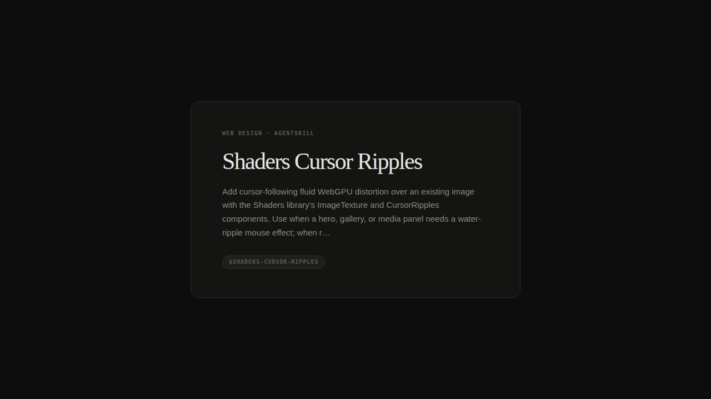

### skeuomorphic-ui

Create skeuomorphic web UI surfaces with layered gradients, stacked inner and outer shadows, reflective gradient borders, micro texture, and embossed text or icon details. Use when asked for pressed, carved, tactile, realistic, soft-plastic, soft-metal, or premium physical interface styling.

[Open demo](agent-skills/web-design/skeuomorphic-ui/demo/index.html) · [Skill](agent-skills/web-design/skeuomorphic-ui/SKILL.md) · [Prompt](agent-skills/web-design/skeuomorphic-ui/demo/PROMPT.md) · Neuform #1 · 2,154 views

### solar-duotone-bold

Use Iconify Solar Duotone Bold icon style.

[Open demo](agent-skills/web-design/solar-duotone-bold/demo/index.html) · [Skill](agent-skills/web-design/solar-duotone-bold/SKILL.md) · [Prompt](agent-skills/web-design/solar-duotone-bold/demo/PROMPT.md) · Neuform #1 · 351 views

### split-layout-technical

Create a technical split-screen design system with dual panels, fine frame lines, mono metadata, quiet editorial typography, and premium inset surfaces.

[Open demo](agent-skills/web-design/split-layout-technical/demo/index.html) · [Skill](agent-skills/web-design/split-layout-technical/SKILL.md) · [Prompt](agent-skills/web-design/split-layout-technical/demo/PROMPT.md) · Neuform #1 · 2,154 views

### staggered-word-reveal

Create subtle editorial word-by-word text reveal animations where each word fades and rises into place once it enters the viewport. Use for premium portfolio headlines, hero copy, section intros, and short marketing text that needs a cinematic staggered reveal with IntersectionObserver or in-view detection.

[Open demo](agent-skills/web-design/staggered-word-reveal/demo/index.html) · [Skill](agent-skills/web-design/staggered-word-reveal/SKILL.md) · [Prompt](agent-skills/web-design/staggered-word-reveal/demo/PROMPT.md) · Local demo

### tailwindcss

Use when designing/implementing UI with Tailwind CSS (layout, typography, responsive, theming, component patterns). Includes quick recipes and conventions for clean, consistent web design.

[Open demo](agent-skills/web-design/tailwindcss/demo/index.html) · [Skill](agent-skills/web-design/tailwindcss/SKILL.md) · [Prompt](agent-skills/web-design/tailwindcss/demo/PROMPT.md) · Local demo

### tech-green-dark-mode-modern

Create a modern dark-mode technical design system with matte-black surfaces, emerald signal accents, mono system labeling, framed dashboard cards, and restrained glow.

[Open demo](agent-skills/web-design/tech-green-dark-mode-modern/demo/index.html) · [Skill](agent-skills/web-design/tech-green-dark-mode-modern/SKILL.md) · [Prompt](agent-skills/web-design/tech-green-dark-mode-modern/demo/PROMPT.md) · Local demo

### technical-wireframe-info-layout

Create a monochrome technical wireframe design system with exploded 3D structure, connector annotations, sparse information labels, and precise dark diagnostic framing.

[Open demo](agent-skills/web-design/technical-wireframe-info-layout/demo/index.html) · [Skill](agent-skills/web-design/technical-wireframe-info-layout/SKILL.md) · [Prompt](agent-skills/web-design/technical-wireframe-info-layout/demo/PROMPT.md) · Neuform #1 · 1,424 views

### thinking-orbs

Add accessible animated AI loading and agent-status indicators with the React thinking-orbs library. Use when a chat, copilot, voice, search, generation, or tool-running interface needs a semantic working, searching, solving, listening, composing, or shaping state; when replacing a generic spinner with an AI activity orb; or when implementing the library's size, theme, speed, pause, reduced-motion, and canvas behavior.

[Open demo](agent-skills/web-design/thinking-orbs/demo/index.html) · [Skill](agent-skills/web-design/thinking-orbs/SKILL.md) · [Prompt](agent-skills/web-design/thinking-orbs/demo/PROMPT.md) · Local demo

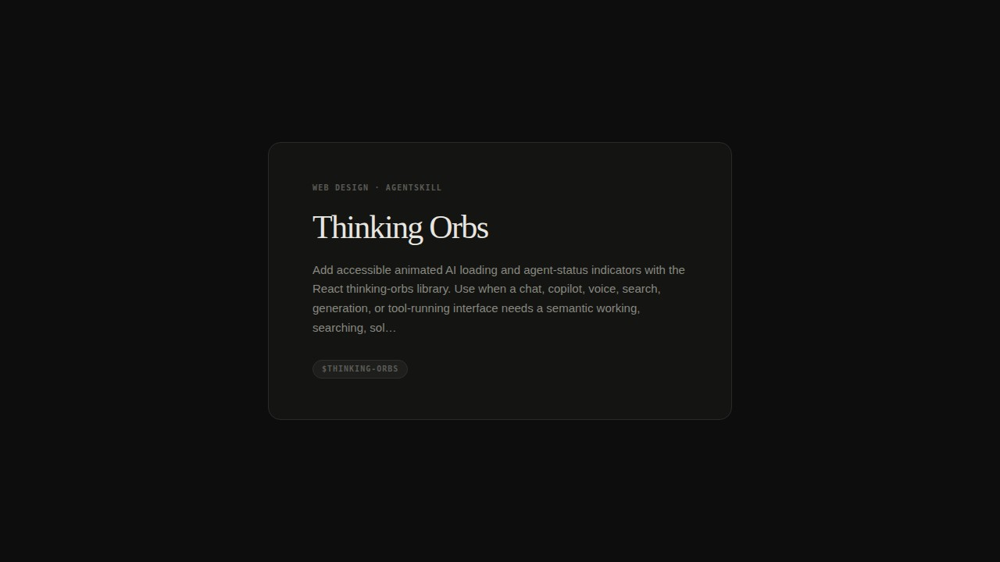

### threejs-landscape

Build a live Three.js landscape that stays quiet behind a subject — a noise heightfield on a polar grid so resolution follows the lens, ground coloured by slope and moisture rather than by texture, instanced GPU grass whose wind costs nothing on the CPU, scattered stones, a gradient sky dome, a star field you can actually see, and a time-of-day system that cross-fades instead of cutting. Use for hero backdrops, product stages, scroll worlds, or any scene where a building, object, or figure has to sit in a place rather than float on a gradient.

[Open demo](agent-skills/web-design/threejs-landscape/demo/index.html) · [Skill](agent-skills/web-design/threejs-landscape/SKILL.md) · [Prompt](agent-skills/web-design/threejs-landscape/demo/PROMPT.md) · Local demo

### threejs-towers

Generate architecture procedurally in Three.js and film it assembling — a small geometry vocabulary that builds pagodas, castles, domes and spires from parameters instead of mesh files, hip roofs with flying eaves driven by a single profile function, and a clipping-plane build animation where everything below a rising line is finished work and scaffolding stands above it. Use for construction studies, architectural title sequences, procedural landmarks, or any hero object that should build itself rather than fade in.

[Open demo](agent-skills/web-design/threejs-towers/demo/index.html) · [Skill](agent-skills/web-design/threejs-towers/SKILL.md) · [Prompt](agent-skills/web-design/threejs-towers/demo/PROMPT.md) · Local demo

### threejs-weather

Put weather into a Three.js scene that reads as weather — rain anchored inside the frustum, a storm that is the rain leaned on rather than a second system, lightning on its own light with thunder scheduled by distance, snow that blows up into blizzards and keeps settling until the ground goes white, wet ground with puddles and splashes, and looping ambience that has no seam. Use for scene atmosphere, seasonal states, hero backdrops, or any world where clear/rain/storm/snow needs to be a control the viewer can turn.

[Open demo](agent-skills/web-design/threejs-weather/demo/index.html) · [Skill](agent-skills/web-design/threejs-weather/SKILL.md) · [Prompt](agent-skills/web-design/threejs-weather/demo/PROMPT.md) · Local demo

### threejs

Use when building or debugging interactive 3D scenes on the web with Three.js (scene/camera/renderer, lights/materials, GLTF loading, controls, performance). Helpful for designers shipping 3D UI moments.

[Open demo](agent-skills/web-design/threejs/demo/index.html) · [Skill](agent-skills/web-design/threejs/SKILL.md) · [Prompt](agent-skills/web-design/threejs/demo/PROMPT.md) · Local demo

### unicorn-studio

Use when embedding and customizing Unicorn Studio interactive animations on the web (embed, responsive sizing, performance, layering with UI, fallbacks).

[Open demo](agent-skills/web-design/unicorn-studio/demo/index.html) · [Skill](agent-skills/web-design/unicorn-studio/SKILL.md) · [Prompt](agent-skills/web-design/unicorn-studio/demo/PROMPT.md) · Local demo

### vantajs

Use when adding animated WebGL background effects with Vanta.js (setup, parameters, resizing, performance, integration in React/Next.js).

[Open demo](agent-skills/web-design/vantajs/demo/index.html) · [Skill](agent-skills/web-design/vantajs/SKILL.md) · [Prompt](agent-skills/web-design/vantajs/demo/PROMPT.md) · Local demo

### webgl-3d-object

Create a real 3D WebGL object with geometric mesh depth, physically based material, directional and ambient lighting, perspective camera, subtle rotation, and floating motion. Use when a page needs a faceted 3D hero object or product-like visual with real lighting instead of CSS transform tricks.

[Open demo](agent-skills/web-design/webgl-3d-object/demo/index.html) · [Skill](agent-skills/web-design/webgl-3d-object/SKILL.md) · [Prompt](agent-skills/web-design/webgl-3d-object/demo/PROMPT.md) · Neuform #1 · 405 views

### webgl-landing-steering

Use when creating or refining WebGL-heavy landing pages and you need to steer toward a specific visual outcome (premium, technical, playful, cinematic) while balancing conversion clarity, performance, and implementation complexity.

[Open demo](agent-skills/web-design/webgl-landing-steering/demo/index.html) · [Skill](agent-skills/web-design/webgl-landing-steering/SKILL.md) · [Prompt](agent-skills/web-design/webgl-landing-steering/demo/PROMPT.md) · Local demo

### webgl-laser

Create a fixed full-screen WebGL laser background effect with a thin white-hot vertical core, restrained brand-colored halo, and soft smoky fog around the beam. Use only for laser background effects, not full page layout, copy, generic hero scenes, particles, or unrelated motion systems.

[Open demo](agent-skills/web-design/webgl-laser/demo/index.html) · [Skill](agent-skills/web-design/webgl-laser/SKILL.md) · [Prompt](agent-skills/web-design/webgl-laser/demo/PROMPT.md) · Neuform #1 · 351 views

